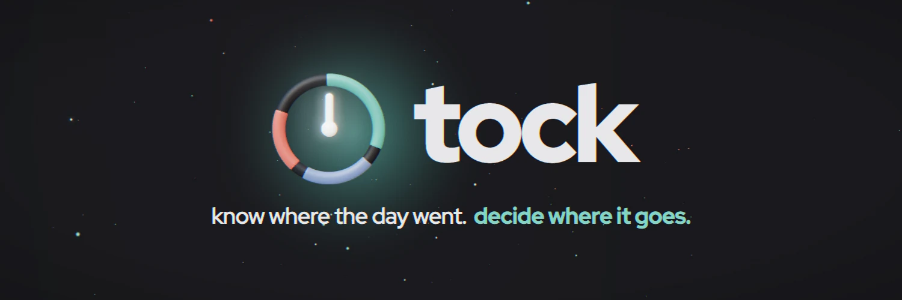

<h1 align="center">
  
</h1>

<p align="center">
  <a href="https://github.com/confuserdotcom/tock/actions/workflows/ci.yml"></a>
  <a href="LICENSE"></a>
</p>

<p align="center">
  <a href="#install">Install</a> ·
  <a href="docs/guide.md">Guide</a> ·
  <a href="docs/privacy.md">Privacy</a> ·
  <a href="CHANGELOG.md">Changelog</a>
</p>

tock records where your working time goes without a timer. A small daemon
notes the app, window and site in front of you; rules you write in a TOML
file turn that into categories and projects. It runs on macOS and on Linux
under Hyprland, Sway, i3 or X11, with Windows experimental, and everything
stays in one SQLite file on your machine.

It is for people who work at a computer for themselves (freelancers,
developers, students) and want an honest record of the day without running
a timer. If you work with coding agents, it also keeps the other half of
the ledger: what your agents worked on today, and what you did while they
ran.

```
$ tock agents --week
project   agent     you  prompts  sessions
tock       4h36    1h51       54         7
agents worked 4h36 · you 1h51 in their windows · 2.5× leverage
```


What's in it:

- `trackd`, the recorder. No network code, under 1 % CPU and about 45 MB.
- `tock`, the CLI and a terminal UI, plus a dashboard on 127.0.0.1.
- `tockbar`, a macOS menu bar app that also draws a panel around the notch.
- Rules in `~/.config/tock/rules.toml`. They apply to past days too, so
  fixing a rule fixes the record. Time no rule covers lands in an inbox;
  labelling it there writes a rule for next time.
- A small local model trained on your own labels, for suggestions.
- Rates per project and numbered invoices (`tock invoice issue`) that
  don't change when you relabel later.
- Optional focus sessions, work hours, calendar, sync between machines,
  and Claude suggestions. All of the network ones are off by default.


## Why you can trust it

A tracker sees every window you open, so it has to earn its place.

- **The recorder cannot phone home.** `trackd` and the menu bar app have no
  network code; a test fails the build if either links an HTTP or TLS
  client. Only `tock` talks to the network, for features that are off
  until you turn them on. [Privacy](docs/privacy.md) lists each one and
  what it sends.
- **No telemetry.** No usage data, crash reports or analytics.
- **It is all here to read.** MIT licensed, and Homebrew builds it from
  this source on your own Mac.
- **Downloads can be checked.** [docs/verify.md](docs/verify.md) shows how
  to check a release against `SHA256SUMS` and GitHub's signed build record.
- **Your data is one file you own.** `tock export` writes it out as CSV or
  JSON, and `tock uninstall --purge` removes every trace.
- **What it does not have yet:** an Apple Developer ID. The `.dmg` is not
  notarized and `tock setup` signs with a certificate made on your machine.

## Why not ActivityWatch

[ActivityWatch](https://activitywatch.net) is the closest thing: free,
open, local, and on more platforms, with watchers and plugins for much
more than windows. If that is what you need, use it.

tock is narrower. It goes from the record to labelled time to an invoice;
it asks about unlabelled time once and turns the answer into a rule; and
it counts your coding agents' work next to your own. Coming from
ActivityWatch, `tock import activitywatch export.json` brings your history.

## Install

macOS, with Homebrew:

```sh
brew tap confuserdotcom/tock
brew trust confuserdotcom/tock
brew install tock
tock setup
```

`tock setup` makes a local code-signing certificate (so the Accessibility
grant survives upgrades), installs and starts trackd and the menu bar app,
and writes starter rules. Run it again after `brew upgrade tock`. trackd
asks for Accessibility on first start; browsers ask for Automation.

There's also a `.dmg` on the [releases page](https://github.com/confuserdotcom/tock/releases).
It isn't notarized (no Apple Developer ID), so the first open needs
System Settings → Privacy & Security → Open Anyway.

From source, with Go 1.26 and the Xcode command line tools:

```sh
git clone https://github.com/confuserdotcom/tock && cd tock
make cert cert-trust   # once
make install
```

Linux (Hyprland, Sway, i3 or X11; see the guide's Linux section): `make install-linux`, or the tarball from the releases
page. [docs/verify.md](docs/verify.md) shows how to check any download
against `SHA256SUMS` and GitHub's signed build record:

```sh
tar xzf tock-v*-linux-amd64.tar.gz && cd tock-v*-linux-amd64
install -m 755 trackd tock ~/.local/bin/ && ~/.local/bin/trackd install && tock init
```

Windows 10 and 11 are experimental, not in a release yet. Build it with
`make build-windows` (binaries land in `build/windows-amd64`), keep
`tock.exe` and `trackd.exe` in one folder, then run `tock init` and
`trackd install`: trackd starts now and whenever you sign in
(`trackd uninstall` undoes it). Bug reports from Windows are especially welcome.

`tock uninstall` removes it again (`--purge` deletes your data too).

## Using it

```sh
tock                      # terminal UI (? for keys)
tock today                # the day as text
tock web                  # the dashboard
tock inbox                # unlabelled time, grouped
tock tag 1 Code/tock      # label it and learn a rule
tock rules check          # after editing rules.toml
tock session start 50     # a 50-minute focus session
```


## Docs

- [Guide](docs/guide.md): every command, file and setting.
- [Architecture](docs/architecture.md): how the pieces fit together.
- [Privacy](docs/privacy.md): what is recorded and what can leave the machine.
- [Stability](docs/stability.md): what stays the same between releases, and how well each platform is supported.
- [CHANGELOG](CHANGELOG.md)

The same pages are at [confuserdotcom.github.io/tock](https://confuserdotcom.github.io/tock/).

## Development

```sh
make test                                   # vet, build, tests
go test ./internal/tui -run Golden -update  # regenerate TUI snapshots
make web-check                              # rebuild the dashboard bundle
```

See [CONTRIBUTING.md](CONTRIBUTING.md). tock is in a feature freeze until
ten people besides its author use it: fixes and polish are welcome, new
platforms and integrations wait. If you use it, say so in an issue; that is
what ends the freeze.

## License

MIT
