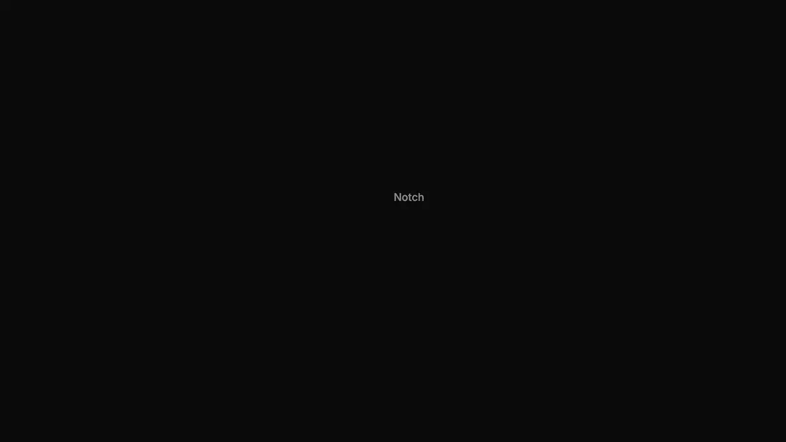
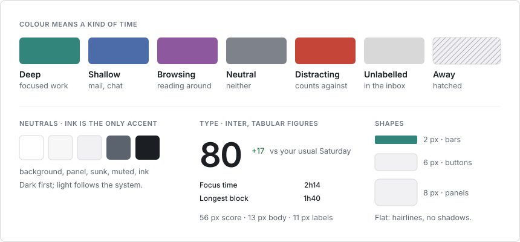

# tock

[](https://github.com/confuserdotcom/tock/actions/workflows/ci.yml)
[](LICENSE)

tock keeps a record of your working time that you never have to start,
stop or fill in. It runs on a Mac or on Linux under Hyprland, labels the
time with rules you can read, and turns it into invoices that don't
change once issued. Your data stays on your machine, in one
SQLite file.

- **Automatic.** A small daemon notes the app, window and site in front
  of you. There is no timer.
- **Explainable.** Every label comes from a rule you wrote, a label you
  gave, or a local model, and says which. A rule shows the time it
  labels before you save it.
- **Billable.** Rates per project, exact amounts, and issued invoices
  that keep their numbers when labels change later.

It is made for developers and freelancers first. It works for study and
side projects too.


**Today.** Every app, window and site you used, on one timeline with a
row per category, and the day's totals by category and project.

## Bill from the record

Give a project a rate, and an optional client, with `tock project` or in
the Library:

```sh
tock project set acme --rate 80 --client "Acme Ltd"
tock invoice --project acme --from 2026-11-01 --to 2026-11-30       # a preview marked DRAFT
tock invoice issue --project acme --from 2026-11-01 --to 2026-11-30 # 2026-0007, stored
```

An issued invoice gets the next number of the year and is stored with its
PDF in the database and in `~/.local/share/tock/invoices/`. Relabelling
the month later, raising the rate or editing your address changes nothing
in it: `tock invoice check 2026-0007` tells you how today's labels would
differ. A mistake is fixed with a void, which needs a reason, and a new
invoice that replaces the old one. Amounts are exact to the cent, days can
be rounded up to the quarter hour, and an invoice can carry tax numbers
and one tax rate. Backups include the invoices, and a restore warns before
it would lose one.

## Every label says why

Each entry carries where its category and project came from: a rule, a
label you gave, the model, or nothing yet. `tock export` writes it in its
own columns, and `tock model why` says why the model chose what it did.
The Rules list (below) shows the time each rule labels and which rules
never win, and a new rule previews what it would relabel before you save
it. Rules apply to past days too, so fixing one fixes the record.

## Fix the record


Click a bar to label it, or drag across the lanes to pick a range: label
it, add time tock didn't see, or delete it. Every change can be undone
from its toast.

## Label each thing once


Time no rule covers waits in the inbox, grouped by app, site or title.
Labelling it writes a rule, so tock files the same thing by itself from
then on. A model trained on your own labels, on your machine, suggests
the rest.

## The week, and the month


The week shows hours per day, when in the day you focus, and where the
time went by project. **Export** saves the week report, the entries as CSV
or JSON, hours by project with your rates, or an invoice preview for one
project. `tock invoice issue` issues it: numbered, stored, and never
changed after.


Trends puts the month on a calendar shaded by deep time, next to deep
time and the score per day.

## Your names, kept tidy


Library lists every category, project and goal with the time each got
lately, so stale names stand out. Rename, re-file, archive or set a rate
from the sheet: rules, goals and past entries follow the new name.
Look-alike names get a merge hint.


**Rules** lists every rule in the order tock checks them, with the time
each labelled lately, and says which never match. Change one, delete a
wrong one (learned ones too), or add one, with a preview of what it would
relabel before you save.


`⌘K` jumps to any view or any date.

## Focus, if you want it



The menu bar app draws a panel around the notch, or a notch of its own on
a screen without one. A focus session counts down beside it and calls you
back when you drift. When the session ends it shows how it went. Unlabelled
time can be labelled there with one pick, and each pick saves a rule. It
warns before meetings and shows a recap in the evening. A moment you
missed waits as a dot.

Sessions, the focus score, break reminders and the daily notices are
groups you can turn off with `tock choice focus off` and `tock choice
routine off`. Off, they leave the TUI, the dashboard, the menu bar and the
notch, and the record is the same.

## Also for study and side projects

Categories, projects and goals don't assume client work. A course can be
a project with a weekly goal, a side project can have its own rules, and
Billing can be turned off (`tock choice billing off`) so no rates or
invoices show anywhere.

## How it works

- `trackd`, a small daemon, records the app and window in front and the
  browser URL, and notices when you are away. It has no network code. It
  uses about 0.5 % CPU averaged over a day (about 1.3 % while a browser
  is in front) and about 36 MB of memory.
- `rules.toml` maps apps, titles and sites to categories and projects. A
  rule applies to past days as well as new ones.
- Time no rule covers goes to an inbox. Labelling an entry there also writes
  a rule, so you label each thing once. A model trained on your own labels,
  on your machine, suggests labels for the rest.
- `tock` is the CLI and a terminal UI. On a Mac the dashboard opens in its
  own window from the menu bar; `tock web` serves it on 127.0.0.1 for any
  browser. The menu bar app shows today's time, draws the notch panel and
  starts focus sessions (`⌥⌘F` from any app).

The focus score adds up deep time, long unbroken blocks and few
switches, minus distraction.


How a span gets its label, how the notch is fed and how the install
signs the apps are drawn in [Architecture](docs/architecture.md).

Optional, and off until you turn them on: the break and wake screens,
work hours, a calendar view, git commit counts, sync between machines, and
Claude suggestions and summaries. See [the guide](docs/guide.md).

## Privacy

- Activity is stored in `~/.local/share/tock/tock.db` (mode 0600) and never
  leaves the machine unless you export it or set up a sync folder.
- A test fails the build if `trackd` ever links an HTTP or TLS client.
- Private browsing windows, and apps and sites you hide, are recorded
  without title or URL.
- The only features that use the network are Claude suggestions and
  summaries and Slack status. All three are off by default. `--dry-run`
  prints exactly what would be sent.

The full list is in [Privacy in detail](docs/guide.md#privacy-in-detail);
[docs/privacy.md](docs/privacy.md) says what is recorded and what can leave
your machine.

## Install

**macOS, with Homebrew:**

```sh
brew tap confuserdotcom/tock
brew trust confuserdotcom/tock   # Homebrew loads no other tap until you trust it
brew install tock
tock setup
```

Homebrew builds tock on your Mac, so macOS never shows an "unidentified
developer" warning. `tock setup` makes a code-signing certificate that
stays in your login keychain (macOS asks for your password once to trust
it), installs `trackd.app` and the menu bar app, starts them, writes
starter rules to `~/.config/tock/rules.toml` and runs `tock doctor`. On
first start trackd asks for Accessibility, and browsers ask for
Automation. After `brew upgrade tock`, run `tock setup` again. macOS ties
the Accessibility grant to the certificate, so updates keep it.
`tock setup --check` shows what is missing.

**macOS, without Homebrew:** download `tock-<version>.dmg` from
[Releases](https://github.com/confuserdotcom/tock/releases) (Apple Silicon
and Intel). tock has no paid Apple Developer ID, so the download isn't
notarized and macOS stops it the first time:

1. Open the .dmg and drag tock to Applications.
2. Open tock from Applications. macOS says it can't check it for malicious
   software. Click Done.
3. Open System Settings, then Privacy & Security. Under Security, click
   Open Anyway next to the line about tock, and confirm.

tock then asks to set itself up and does what `tock setup` does, including
`tock` in `~/.local/bin`. Opened again later, it shows the dashboard. To
update, drag the new version over the old one and open it.

**macOS, from source:** you need Go 1.26 and the Xcode command line tools
(`xcode-select --install`).

```sh
git clone https://github.com/confuserdotcom/tock && cd tock
make cert          # once: a local code-signing certificate
make cert-trust    # once: approve the macOS dialog that trusts it
make install       # builds, signs, starts trackd, runs tock doctor
```

`make install` puts `tock` in `~/.local/bin` (add it to `PATH`) and does
the rest of what `tock setup` does.

**Linux (Hyprland):** `make install-linux`, or with Homebrew on Linux
the same `brew install` and `tock setup` as on macOS. Without Go, download
`tock-<version>-linux-amd64.tar.gz` (or `arm64`) from
[Releases](https://github.com/confuserdotcom/tock/releases), check it
against `SHA256SUMS`, and run:

```sh
v=v5.3.0   # the version you downloaded
tar xzf tock-$v-linux-amd64.tar.gz && cd tock-$v-linux-amd64
install -m 755 trackd tock ~/.local/bin/ && ~/.local/bin/trackd install && tock init
```

**From ActivityWatch:** `tock import activitywatch export.json` brings in
your history and labels it with your rules.

**Removing it:** `tock uninstall` stops trackd and the menu bar and
removes the apps. `--purge` also deletes your data. A Homebrew install
then needs `brew uninstall tock` for the command itself.

## First day

1. Work as usual. `tock` opens the terminal UI. `tock today` prints the day.
   `tock web` opens the dashboard.
2. `tock inbox` lists unlabelled time grouped by app, site or title.
   `tock tag 1 Code/tock` labels the first entry and learns a rule for it.
3. Edit `~/.config/tock/rules.toml` for broader rules, then run
   `tock rules check`.
4. `tock session start 50` starts a 50-minute focus session.

In the terminal UI, `?` lists the keys and `:` opens a command palette.


## Design



The dashboard, the terminal UI, the menu bar and the notch share one set of
colours: colour only ever means a kind of time. [DESIGN.md](DESIGN.md) has
the tokens, the type scale, the components and the motion rules.

## Documentation

- [confuserdotcom.github.io/tock](https://confuserdotcom.github.io/tock/): the guide and the architecture as a site.
- [Guide](docs/guide.md): every command, file and feature.
- [Product](docs/product.md): what tock is for, who it is for first, and what it won't do.
- [Privacy](docs/privacy.md): what is recorded and what can leave your machine.
- [Architecture](docs/architecture.md): how the pieces fit, with diagrams, and what they cost.
- [Stability](docs/stability.md): what tock promises about your data, upgrades and cost, and what a release must pass.
- [CHANGELOG](CHANGELOG.md): what changed in each release.
- [DESIGN.md](DESIGN.md): the design system for the dashboard, TUI and menu.

## Development

```sh
make test                                  # vet, build, all tests
go test ./internal/tui -run Golden -update # regenerate TUI snapshots
TOCK_DEMO_PORT=7788 go test -tags demo -run TestDemo -timeout 0 ./internal/web
                                           # the dashboard on demo data
```

CI runs gofmt, vet, the build without cgo and the tests on Linux, and the
cgo build and tests on macOS. To release, add a `## vX.Y.Z` section to
CHANGELOG.md and push the tag. CI builds the Linux tarballs, the source
tarball and Homebrew formula, and the .dmg, and publishes the release.

## License

MIT. See [LICENSE](LICENSE).
