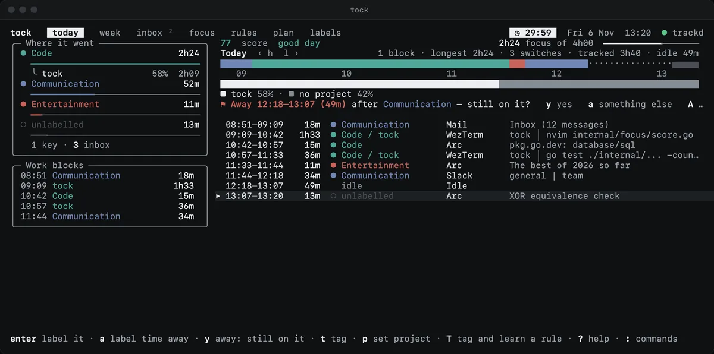
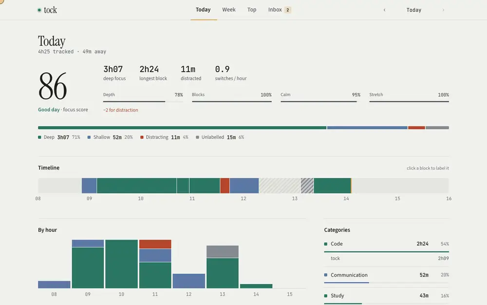
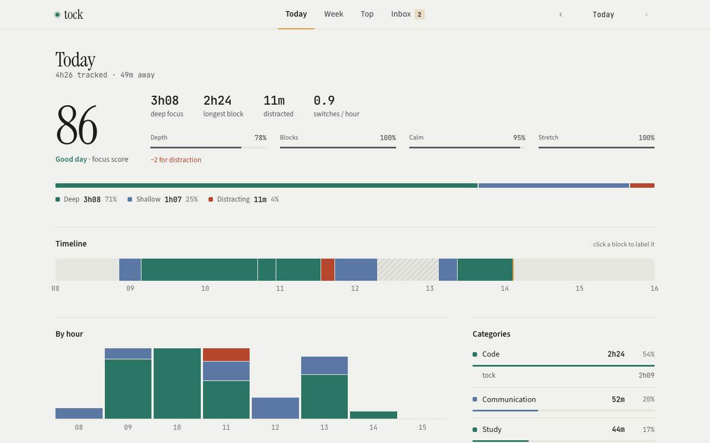

<p align="center">
  <b>Your working day, written down for you.</b><br>
  A small daemon records what is in front, your rules label it, and a score says how deep it went. Nothing leaves your Mac.
</p>

<p align="center">
  <a href="https://github.com/confuserdotcom/tock/stargazers"></a>
  <a href="https://github.com/confuserdotcom/tock/commits/main"></a>
  
  
  
  
</p>

<p align="center">
  <a href="#what-you-get">What you get</a> ·
  <a href="#privacy">Privacy</a> ·
  <a href="#install">Install</a> ·
  <a href="#first-day">First day</a> ·
  <a href="#tui-keys">Keys</a> ·
  <a href="#reference">Reference</a>
</p>

tock tracks where your time goes on a Mac, and on Linux under Hyprland. A
small daemon, `trackd`, records which app and window is in front, all day,
into a local SQLite database. The `tock` command and its terminal UI label
that time with your own rules, score your focus, run focus sessions and help
you label what is left.

You never start a timer. You open `tock` when you want to know where the
day went, and it is already there.

## What you get



<p align="center">▶ <a href="docs/readme/tui.mp4"><b>Watch the full-quality video</b></a></p>

- **Tracking you don't run.** `trackd` follows the front app, window title
  and browser URL, notices when you are away, and costs under 1 % CPU.
- **Labels from your rules.** A `rules.toml` of categories, projects and
  patterns labels the day, past days included. What no rule covers lands in
  an inbox, where one key labels it and learns a rule, and a small model
  trained on your own labels suggests the rest.
- **A focus score for the day.** Depth, unbroken blocks and calm, minus
  distraction, out of 100, and `i` shows exactly how it was added up.
- **Focus sessions that pull you back.** Start one from the TUI, the menu
  bar or `⌥⌘F` anywhere, with a goal. Drift to a distraction and tock tells
  you; with the wake screen on, a banner and then a full-screen curtain
  bring you back.
- **A calm menu bar.** Today's time, a strip of the day, one Start button,
  and a Settings menu that turns features on and off.
- **Goals, plans, routines, a calendar, week reports, billing, git
  commits**, all read from local files and never sent anywhere.
- **Claude, if you want it.** Suggestions for the inbox, daily summaries
  and `tock ask` run on your Claude subscription, through privacy filters,
  only when you turn them on.

### The dashboard

`tock web` (or **Open dashboard** in the menu bar) serves the same day as a
page on `127.0.0.1`, in paper by day and ink at night. Click a block of the
timeline to label it.



<p align="center">▶ <a href="docs/readme/web.mp4"><b>Watch the full-quality video</b></a></p>

<picture>
  <source media="(prefers-color-scheme: dark)" srcset="docs/readme/web-dark.png">
  
</picture>

## Privacy

- Everything stays on your Mac, in `~/.local/share/tock/tock.db` (mode 0600).
- The model that labels what the rules miss is trained and run on this
  machine (see The model).
- `trackd` contains no network code at all; a test fails the build if it ever
  links an HTTP or TLS client.
- Private-browsing windows are recorded as "<app> (private)", with no title or
  URL. Apps and sites you hide (**Settings ▸ Privacy** in the menu bar, or
  `[privacy] hide_apps` / `hide_sites`) are recorded the same way.
- Claude suggestions, summaries and `tock ask` are the only features that talk
  to the internet. They run through Claude Code (`claude -p`, on your Claude
  subscription: no API key, no tools, no saved session), or through the API
  when `ANTHROPIC_API_KEY` is set in the shell that runs `tock`. With neither,
  they are off.
  - When on, at most once an hour, tock sends the grouped inbox keys: app name, URL host, cleaned title and minutes. It also sends your category and project names.
  - Password managers, mail and messaging apps, banks and webmail are never sent. Extend the deny lists in `config.toml [llm]`.
  - `tock summary` runs only when you type it. It sends the day's work blocks: the weekday (never the date), clock times, minutes, labels and, per block, at most 8 apps with their URL host or cleaned title, through the same deny lists. The answer is saved in tock.db.
  - `tock ask` sends only your question, today's date and your category and project names. Claude answers with a query, and tock runs it on this machine: no activity is sent.
  - `--dry-run` on `tock suggest`, `tock summary` and `tock ask` prints the exact payload without sending it.
  - The key is read from the environment only and is never written anywhere.
- Slack status (opt-in) is the only other network use: `tock slack`, run by
  trackd when a session starts and ends, sets your status and
  do-not-disturb. Nothing about your activity is sent, only the status text
  you chose and the session's end time.
- `tock export` prints titles and URLs to stdout. Where that output goes is up to you.
- `[privacy] keep_titles = 30` deletes window titles, and cuts URLs to their
  host, once they are 30 days old (see Deleting old titles).
- Screen reading (opt-in, `[ocr]`) reads the text of unclear windows with
  Apple Vision on this Mac. Screenshots never touch the disk; only a few
  plain keywords per window are kept, and they are never sent anywhere,
  synced or exported (see Screen reading).
- Calendar events (opt-in) are read through macOS Calendar, never fetched, and
  stay in tock.db. They are never sent to Claude.
- Commit counts come from `git log` on your local repos: only author times
  are read, never messages or code.
- Sync between machines (opt-in) only writes and reads files in a folder you
  choose; moving that folder between machines is up to your own sync tool.
- `tock web` listens on 127.0.0.1 only, while it runs. Each run makes a new
  secret token that the page needs for every request. The page loads nothing
  from the internet.

## Requirements

- macOS (developed and tested on macOS 26), or Linux with Hyprland (see
  [Linux](#linux-hyprland))
- Go 1.26 and the Xcode command line tools (`xcode-select --install`), since
  `trackd` uses cgo

## Install

```sh
make cert          # once: creates the local code-signing identity
make cert-trust    # once: you approve a macOS dialog to trust it
make install       # builds, signs, installs, starts trackd, runs tock doctor
```

`make install` puts:
- `tock` in `~/.local/bin`, so add that directory to `PATH`;
- the signed `trackd.app` in `~/.local/share/tock`;
- a launchd agent, `com.tock.trackd`, that starts at login;
- the menu bar app `tock.app` and its agent `com.tock.bar` (see
  [Menu bar and notifications](#menu-bar-and-notifications)).

It also writes the starter `~/.config/tock/rules.toml` if you have none.

trackd asks for **Accessibility** (window titles) on first start. `tock doctor --open` opens the right System Settings pane if it is still missing. Browsers ask for **Automation** (URLs) the first time trackd reads them. Run `tock doctor` any time:

```
ok  rules: 22 rules, 0 learned
ok  config: defaults (no config.toml)
ok  trackd: running (version 3f2a1c0)
ok  accessibility: granted
ok  notifications: native, with buttons (menu bar)
ok  automation: no browser denied
ok  suggestions: on via your Claude subscription (claude CLI)
```

Permissions are tied to the signing certificate, so they survive rebuilds.
`SIGN_MODE=adhoc make install` works without a certificate, but macOS then
forgets the grants on every rebuild.

## First day

1. Work normally. `tock` opens the TUI. `tock today` prints the day.
2. `tock inbox` lists time no rule labels yet, grouped by key: one row per
   app and site (`Arc · youtube.com · 4 pages`), one per app and cleaned
   title otherwise. Numbered CDN or viewer hosts fold into their domain
   (`doc-0o-bs.googleusercontent.com` is `googleusercontent.com`). Keys with
   less than 2 minutes in the window are summed in one line
   (`+ 46 small keys under 2m`); `tock inbox --all` lists them, and
   `[inbox] min_minutes` sets the floor. Label a key with
   `tock tag 1 Code/tock`. This also writes a rule to
   `~/.config/tock/learned.toml`, so the same activity is labelled from now on.
   In the TUI, use the inbox tab's `enter`.
   When a key looks like time you already labelled (the same site or app,
   similar titles, or between two spans with one label), the inbox shows a
   guess such as `→ Code (same app, 82%)`. `tock tag 1` with no label
   accepts it. Guesses are computed on your machine; nothing is sent.
   A same-site or same-app guess of 85 % or more (`[inbox] auto_accept`) is
   applied for you: tock learns its rule as `tock tag` would, and the inbox
   says `auto-labelled 3 keys (12m) today`. `tock inbox --auto` lists them;
   `tock tag <n> <label>` on that list corrects one, and tock never
   auto-labels that key again. `tock undo` also reverts each rule.
   Tagged it wrong? Tag it again (or `t` on the row in today): the new rule
   replaces the mistaken learned one, so every span it labelled changes.
3. Edit `~/.config/tock/rules.toml` for anything broader, then run
   `tock rules check`. You can also use the rules tab: `J`/`K` reorder, `e`
   opens the file in `$EDITOR`. A rule changes past days as well as future
   ones, except spans you tagged by hand.
4. Start a focus session with `tock session start 50` or the focus tab's `s`.
   trackd notifies you when you drift to a distraction and when a break is due.
5. `tock status` prints one line for a status bar, and `tock recap` prints the
   day's recap. trackd also shows the recap at 21:00 (or when your work
   hours end, see Work hours).

## TUI keys

You don't need to learn the keys:

- The footer shows only the keys that work on the selected row.
- `?` lists every key, by tab.
- `:` (or `ctrl+k`) opens the command palette. Type a few letters of what
  you want, such as `week`, `50 min` or `edit rules`, and press enter.

```
1-7 / tab        today · week · inbox · focus · rules · plan · labels
: / ctrl+k       command palette
?                all keys
r · q            refresh · quit

today            enter label the row (accepts a ★ suggestion, or labels time away)
                 t tag · p project only · T tag and learn a rule · i why this score
                 a label the latest time away · A leave it idle
                 s split (label part of the row) · d delete its time · + add time
                 j/k move · h/l previous/next day · . today · / filter
                 c every window ↔ compact rows (labelled rows in a row merge)
week             enter open day · h/l week · . this week · m month trends
inbox            enter accept the suggestion, else learn a rule · T pick a label
                 o tag once · x ignore
anywhere         u undo the last change (tag, rule, ignore, time away, edit)
focus            s start a session · x stop · z snooze or resume distraction notices
                 enter take the pending suggestion · d not now
rules            e edit rules.toml · J/K move a rule down/up
plan             enter/space/x done ↔ not done · a add · d delete · e edit the file
                 f focus session · u undo the tab's last edit
labels           a add a category · m add a module under it · e rename · K kind
                 w afk window · f file a project under a category · l other names
                 x archive · M merge into another · d delete · enter fold
pickers          ★ suggested and ↺ recent labels come first · type to filter · enter · esc
```

Colours follow the kind of time, the same in the TUI, the dashboard and the
menu bar: deep teal for deep work, slate blue for shallow, mauve for
browsing, rust for distraction, grey for the rest, and hatched grey for time
nobody labelled yet. Brass marks the one thing to look at. The palette has
light and dark variants and follows your terminal's background (see
`DESIGN.md`).

The first time you run `tock` without rules, it offers to write the starter
rules.

The mouse works everywhere. Anything that shows a key is a button: the
footer, the help, a dialog's `enter ok`, the `a label` of time away, the
`u undo` after a change. Click a tab to switch, a row to select it and the
selected row again for `enter`. Right-click a row for a menu of what you
can do with it. Hovering shows what a thing is in the footer.

On the today tab, the strip under the score is the day: one cell per slice
of time, coloured by its kind (faint dots are idle). Click a cell, a work
block or an hour of the heatmap to jump to that time; click a category or
a module in Where it went to show only its rows, and again to show all; the
score opens its breakdown. A terminal 130 columns wide or more puts Where
it went, with every module, the goals and the work blocks in a sidebar.

The labels tab (`7`) is where your categories and modules live: each with
its kind, AFK window and 30 days of time. Click a kind or an AFK window to
change it. The label picker (`t`) offers a module as you type its name or
an alias: `ana` → `Study / Analyse 1`.

While tock has the mouse, dragging no longer selects text. Hold Shift (WezTerm,
kitty, most terminals) or Option (Terminal.app, iTerm2) while you drag to
select text anyway.

## Reference

Everything below is the manual, one section per feature:

- **Using it:** [Commands](#commands) · [Choices](#choices) · [Files](#files) · [Plan](#plan) · [Focus guard](#focus-guard) · [Goals](#goals) · [Work hours](#work-hours) · [Routines](#routines) · [Time away](#time-away)
- **Labels:** [Categories](#categories) · [The model](#the-model) · [Modules](#modules) · [AFK](#afk) · [Editing the timeline](#editing-the-timeline) · [Undo](#undo) · [Duplicate names](#duplicate-names)
- **Looking back:** [Work blocks, summaries and questions](#work-blocks-summaries-and-questions) · [Trends and review](#trends-and-review) · [Web dashboard](#web-dashboard) · [Week report](#week-report) · [Billing](#billing) · [Commits](#commits) · [Calls](#calls)
- **Your day around it:** [Calendar](#calendar) · [Planned sessions and meetings](#planned-sessions-and-meetings) · [Recommendations](#recommendations) · [Screen reading](#screen-reading) · [Menu bar and notifications](#menu-bar-and-notifications)
- **Running it:** [Linux (Hyprland)](#linux-hyprland) · [Sync between machines](#sync-between-machines) · [Deleting old titles](#deleting-old-titles) · [Updates](#updates) · [Backup](#backup) · [Uninstall](#uninstall) · [Development](#development)

## Commands

```
tock                                   open the TUI (today, week, inbox, focus, rules)
tock choice [<feature> on|off]         turn features on and off, open the dashboard (see Choices)
tock status                            one line for a status bar
tock init                              write starter ~/.config/tock/rules.toml
tock today [--date YYYY-MM-DD] [--keys]
tock inbox [--days N] [--all | --auto]  unlabelled activity, numbered; --auto: what tock labelled itself
tock tag [--once] <n> [<Category>[/<Project>]]   no label: accept the → suggestion
tock tag --span <id> <Category>[/<Project>]
tock ignore <n> | tock ignore --undo <key>
tock away [--date D] [<HH:MM> <Category>[/<Project>] | <HH:MM> same | --skip <HH:MM>]
                                       label time away (idle or asleep) or leave it idle
tock edit add <HH:MM-HH:MM> <Category>[/<Project>] [note]
                                       add time you forgot to track
tock edit label <HH:MM-HH:MM> <Category>[/<Project>]
                                       label part of a span (a split) or several at once (a merge)
tock edit delete <HH:MM-HH:MM>         remove time, or trim a span's start or end
tock edit [--date D] | tock edit remove <id>   list the day's edits | drop one
tock undo [--list]                     reverse the last change
tock rules check | tock rules stats [--days N]   validate | time each rule decided
tock rules dupes                       look-alike category and project names
tock rules merge [--project] <from> <into>
                                       fold one name into another everywhere
tock session [start [MIN] [--paper] | stop]
                                       focus session: show, start (default 25; --paper: idle is paper work), stop
tock break [MIN]                       take a break now (default 5 min)
tock session snooze [MIN|off]          hold distraction notices back (default [focus] snooze), or resume them
tock recap [YYYY-MM-DD|start|midday]   the daily recap, or a routine notice now
tock recommend [accept | dismiss]      the pending suggestion: show it, take it, or not now
tock ocr test [--now] | grant          read the front window's text once (in 3 s) | ask for Screen Recording
tock trends [--month YYYY-MM] [--hours]  a month against the one before, your best focus hours and
                                       how you answered the suggestions; --hours: focus by weekday and hour
tock top [--days N | --week | --month] [--by category|app|site|project] [--limit N]
                                       where the time went: top categories, apps and sites
tock model [why <app> "<title>" [<label>]]
                                       how well the local model labels; why it labels a window so
tock web [--port N] [--no-open] [--idle D]  the dashboard in your browser, on this machine only
tock review [--week YYYY-MM-DD] [--plan TEXT]
                                       weekly recap, then next week's focus
tock suggest [--dry-run | --force]     Claude label suggestions for the inbox (claude CLI or ANTHROPIC_API_KEY)
tock blocks [--date D]                 the day's work blocks: stretches of work on one thing
tock summary [--date D] [--dry-run]    Claude writes what you worked on (claude CLI or ANTHROPIC_API_KEY)
tock ask [--dry-run] "<question>"      ask about your time in plain words; answered on this machine
tock doctor [--wait] [--open]          check trackd, permissions, rules and config
tock export [--from D] [--to D] [--format csv|json] [--by project]
                                       labelled spans, default the last 7 days as csv
tock backup [--out FILE]               archive tock.db and the rule, config and shell files
tock slack [login | logout | status]   Slack status during focus sessions (see Focus guard)
tock shell-init zsh                    shell hook for terminal projects (docs/shell-hook.md)
```

Names match on a unique prefix: `tock tag 2 stu/atl`.

The export has one row per span:
`id,start,end,duration_s,app,bundle_id,title,url,private,category,kind,project,category_source,project_source,rate,amount`.
Times are RFC 3339 with your local offset. `rate` and `amount` are empty
(`null` in JSON) unless the row's project has a rate (see Billing).

## Choices

`tock choice` lists the features you can turn on and off: local model
labels, Claude, screen text, calendar meetings, notifications, suggestions,
the break screen, the wake screen, blocking, urge surfing, the daily notices, plan reminders
and Slack. Space turns the feature under the cursor on or off, enter saves,
q quits (changes not saved are said so). Each one is a setting in
config.toml (`[ocr] enabled`, `[focus] break_screen`…); tock choice changes
that line only and keeps your comments and every other line, and the old
file stays as `config.toml.bak`. The running apps pick the change up by
themselves.

Turning screen text on asks for the Screen Recording permission; turning
Slack on with no token tells you to run `tock slack login`.

The last row, **Open dashboard**, starts the web dashboard and opens it in
your browser after asking (Open, Not now, or Always to stop asking). It
stops after 30 minutes unused.

Not on a terminal, `tock choice` prints each feature and whether it is on;
`tock choice <feature> on|off` sets one, for scripts and SSH:

```
$ tock choice break_screen on
Break screen: on
```

## Files

| Path | What |
|------|------|
| `~/.config/tock/rules.toml` | your categories, projects and rules; first match wins |
| `~/.config/tock/learned.toml` | rules written by `tock tag`, checked before rules.toml |
| `~/.config/tock/config.toml` | optional settings, see below |
| `~/.config/tock/slack.token` | the Slack token, when you use Slack |
| `~/.local/share/tock/tock.db` | the spans (SQLite) |
| `~/.local/state/tock/trackd.log` | trackd's log |
| `~/.local/state/tock/shell.log` | working directories from the shell hook, see [docs/shell-hook.md](docs/shell-hook.md) |

`TOCK_CONFIG_DIR`, `TOCK_DATA_DIR` and `TOCK_STATE_DIR` override the three
directories.

`config.toml` sections. All keys are optional and the values below are the
defaults:

```toml
[focus]
presets = [25, 50, 90]   # session lengths in minutes; the first is the default
break_after = 50         # minutes of focus before a break reminder
break_repeat = 10        # minutes between reminders
distract_grace = 60      # seconds on a distraction before a nudge
distract_repeat = 120    # seconds between nudges
snooze = 10              # minutes a snooze holds distraction notices back (1 to 240)
urge_surf = false        # the distraction notice asks you to pause and counts your answer
auto_min = 25            # minutes of deep work that count as an unplanned session
recap = "21:00"          # daily recap notification, "" to disable
notify = true
notice_budget = 8        # nudges a day tock sends unasked (break, away, start, midday,
                         # overworking, suggestions); 0 = no limit (0 to 100)
notice_gap = 20          # least minutes between two nudges; 0 = none (0 to 240).
                         # Nudges wait out calls and meetings; session, Break over,
                         # plan and recap notices are never held back
break_screen = false     # a break you took that runs over covers the screens until
                         # you click Back to work or 5 more minutes, or press Esc;
                         # never locks, never during a call, not once back at deep work
break_screen_grace = 5   # minutes past the break's end before it shows (1 to 60)
wake_screen = false      # a session gone off task (distraction, browsing, long idle)
                         # gets a banner at wake_warn minutes, then covers the screens
                         # at wake_after: Back to work, This is work (files the site
                         # under your work label; tock undo takes it back), I'm on
                         # paper (idle stops counting), Snooze, End session. Two a
                         # session at most; never during a call; Esc closes it
wake_warn = 5            # minutes off task before the banner (1 to 60)
wake_after = 10          # minutes off task before the screen, and between two (2 to 120)
wake_idle = 15           # minutes idle before idle counts as off task (1 to 120)
hotkey = true            # ⌥⌘F from any app: what you are working on and how long,
                         # then start (Stop or Keep going while one runs); menu bar app
# meeting_apps / meeting_hosts replace the built-in lists of meeting apps
# (bundle ids) and hosts during which break and distraction nudges stay quiet
block = false            # close distracting tabs and hide distracting apps in sessions
block_apps = []          # bundle ids (Hyprland classes) blocked besides distractions
block_hosts = []         # sites blocked besides distractions; subdomains too
block_grace = 10         # seconds a distraction may stay in front
focus_on = ""            # Shortcuts shortcut run when a session starts
focus_off = ""           # ... and when it ends

[hours]                  # off unless set; see Work hours
days = ["mon", "tue", "wed", "thu", "fri"]
start = "09:00"          # start and end are both required
end = "18:00"
over_grace = 30          # minutes of work past end before the overworking notice (5 to 240)
over_repeat = 60         # minutes between overworking notices while you keep going (15 to 480)

[inbox]
min_minutes = 2          # a key needs this much time in the window for its own inbox row; 0 lists all (0 to 60)
auto_accept = 85         # % a same-site or same-app guess needs to be applied without asking; 0 = off (60 to 100)

[routine]                # notices that mark the day; see Routines
start = true             # start of day notice on the first activity of a work day
midday = "13:00"         # midday check-in time, "off" to disable
end = true               # false turns the recap notice off whatever [focus] recap says
overwork = true          # overworking notice past the end of the work hours

[recommend]              # focus suggestions and the adaptive break; see Recommendations
enabled = true           # false: no suggestions, and the break reminder is the plain one
max_per_day = 2          # focus suggestions a day (0 to 10, 0 = none)
adaptive_break = true    # break reminder after your usual focus stretch
min_days = 7             # active days of the last 28 the profile needs (3 to 28)

[ocr]                    # read on-screen text of unclear windows, on this Mac only; see Screen reading
enabled = false          # off unless set
apps = ["com.apple.Terminal", "com.googlecode.iterm2", "com.mitchellh.ghostty", "net.kovidgoyal.kitty", "com.github.wez.wezterm", "com.apple.Preview", "net.sourceforge.skim-app.skim", "com.readdle.PDFExpert-Mac", "net.ankiweb.launcher", "com.apple.Safari", "com.google.Chrome", "org.mozilla.firefox", "company.thebrowser.Browser", "app.zen-browser.zen"]
interval = 60            # seconds between reads of one window (15 to 3600)
min_dwell = 20           # seconds a window stays in front before its first read (5 to 300)
deny_apps = []           # bundle ids never read, on top of [llm] deny_apps
deny_hosts = []          # RE2 patterns on the URL host, on top of [llm] deny_hosts
deny_titles = []         # RE2 patterns on the title (any case), on top of [llm] deny_titles

[privacy]
keep_titles = 30         # off unless set: days window titles are kept
hide_apps = []           # bundle ids recorded as private time only: no title, no URL
hide_sites = []          # hosts recorded the same way; subdomains too

[invoice]                # for tock invoice; all optional
name = "Your Name"
address = ["1 Main Street", "City"]
currency = "EUR"         # printed after amounts; "" by default
note = "Payment within 30 days."

[slack]                  # see Focus guard
enabled = false
status = "In a focus session"
emoji = ":dart:"
dnd = true               # pause Slack notifications for the session

[llm]
enabled = true                # still needs Claude Code (claude) or ANTHROPIC_API_KEY
model = "claude-haiku-5-5"
min_minutes = 2               # inbox time a key needs before it is sent
deny_apps = []                # bundle ids added to the built-in deny list
deny_hosts = []               # host regexes added to the built-in list
deny_titles = []              # title regexes

[shell]
terminals = [...]             # bundle ids that get shell dirs; replaces the built-in list

[away]                        # which absences tock asks about
min = 10                      # minutes; at least 5
max = 240                     # minutes; at most 720

[afk]                         # when time in front of an app stops counting, see AFK
video = 180                   # minutes without input while a video plays; trackd reads it at start
stale = 20                    # minutes; see "Machines that report no input"
trust = 180                   # minutes; the longest unchanged window hypridle is trusted with

[calendar]                    # meetings from macOS Calendar, see Calendar
enabled = false               # true: trackd asks for calendar access once
calendars = []                # calendar names to read; empty = all
auto_open = false              # open a Meet/Zoom/Teams link by itself when its event starts

[score]                       # weights of the focus score; they sum to 1
depth = 0.5
blocks = 0.3
calm = 0.2
stretch = 0.0                 # longest run without a context switch, full at 1h30
```

## Plan

The plan tab (`6`, or `tock plan`) shows a todo.txt file by day: Overdue,
Today, Tomorrow, Later, No date, and what you ticked today. Inside a day,
tasks go by the time in a context (`@07h30`, `@mon-07h30`, `@07:30`).
Ticking writes `x DATE` and keeps the priority as `pri:A`; unticking puts it
back. A future `t:YYYY-MM-DD` hides a task until that day. Piped, `tock
plan` prints the open tasks.

```toml
[plan]
file = "~/todo.txt"
# optional: run when the tab opens, after each change and once a minute
command = "my-planner --tock"
notify = true        # upcoming and starting-now notices for timed plan items and calendar events
notify_before = 5    # minutes ahead; 0 = no upcoming notice (0..60)
auto_start = false   # a module-tagged plan item starts a focus session of its slot length
```

The last three keys make timed tasks announce themselves, see Planned
sessions and meetings.

The command gets `TOCK_PLAN_FILE` and may rewrite the file (a planner that
rolls missed tasks over, imports ticks). Its output shows above the list:
plain lines, or JSON `{"lines": ["…"], "seen": {"project": seconds}}`,
where `seen` puts the time you spent on a `+project` next to its first open
task today. Edits re-read the file and find the line by its text, so a
command rewriting the file never makes tock tick the wrong task.

## Focus guard

A focus session can do more than nudge you.

**Focus level.** While a session runs, the focus tab, the menu bar and
`tock session` show `focus 84% ↗` next to `deep 62%`. Deep % is the
session's record: deep time over its length so far. The focus level is how
focused you are now: deep work counts fully, light or unlabelled work half,
browsing a quarter, distraction and time away nothing, and a glance away
under a minute between deep work is forgiven. Recent minutes weigh most
(half as much every five minutes back), so after a drop the level climbs
back as soon as you settle in again: five focused minutes win back half the
gap. ↗ or ↘ shows where it moved in the last minute.

**Blocking.** With `block = true` under `[focus]`, a distraction that stays
in front for 10 seconds (`block_grace`) during a session is taken away:

- in Chrome, Arc, Brave and Safari, the front tab is closed, if it still
  shows that site;
- any other app (and Firefox) is hidden. On Hyprland its windows move to
  the special workspace `tock` (`hyprctl dispatch togglespecialworkspace
  tock` brings them back).

A distraction is time whose category has `kind = "distract"`, plus the apps
in `block_apps` and the sites in `block_hosts`. Nothing is blocked during a
call or a meeting, and Finder and tock never are. A notification names the
app, never the site. Closing a tab uses the same Automation permission trackd
already has for reading URLs.

**Answering a distraction notice.** The notice has buttons (Options in
Notification Center). The menu bar offers the same snooze while a session
runs.

- *Snooze N min* holds distraction notices back for `[focus] snooze` minutes.
  `tock session snooze [MIN|off]` does the same from the shell (`off`
  resumes them), and `z` on the focus tab snoozes or resumes. The tab shows
  `notices snoozed until 15:10`. A snooze ends with the session.
- *Don't interrupt for Entertainment* (or *for this rule*) marks that
  category, or the rule that matched, as quiet: it writes `interrupt = false`
  on the `[[category]]` in `rules.toml`, or on the `[[rule]]` in the file it
  lives in. The rules and labels tabs show `quiet` on marked rows. To undo,
  run `tock category set <name> --interrupt on` or delete the line. Marked
  time still counts as distraction in the score and the session's quality;
  only the notice stops. With `block = true` a quiet category is still closed
  or hidden. A `rules.toml` containing `interrupt` is refused by older tock
  builds on another machine until they update.
- With `urge_surf = true` the notice reads "Pause. Breathe. Name the urge."
  and offers *Back to work* or *Open anyway (counted)*. Nothing is opened or
  blocked either way; tock counts your answer on the session. The last-session
  card in the TUI and the menu bar's Last session submenu show
  `urges 2 resisted · 1 given in`.

**Focus mode.** macOS has no command for Focus, but Shortcuts does. In the
Shortcuts app, make a shortcut named `Focus On` with the action *Set Focus*
(Do Not Disturb, or your Work focus, *On*), and a `Focus Off` shortcut that
turns it off. Then:

```toml
[focus]
focus_on = "Focus On"
focus_off = "Focus Off"
```

trackd runs them when a session starts and when it ends, whether you
started it in the TUI, the menu bar or `tock session`. `tock doctor` checks
that both shortcuts exist.

**Slack.** tock can set your Slack status and pause Slack notifications
for the session:

1. Create a Slack app for your workspace at api.slack.com/apps, add the
   user token scopes `users.profile:read`, `users.profile:write` and
   `dnd:write`, install it and copy the user token (`xoxp-…`).
2. `tock slack login` and paste it. It is stored in
   `~/.config/tock/slack.token` (owner-only); `TOCK_SLACK_TOKEN` overrides
   it.
3. `[slack] enabled = true` in config.toml. `tock slack` checks the token.

The status expires on its own at the planned end. When the session ends,
tock clears it only if it is still tock's status, so a status you set
yourself in the meantime stays. trackd never talks to the network itself: it
runs `tock slack start` and `tock slack stop`.

## Goals

`[[goal]]` tables in `rules.toml` set goals (`at_least`) and limits
(`at_most`) per day or week, for a category, a project or both:

```toml
[[goal]]
category = "Study"
at_least = "2h"
per = "day"            # the default; or "week" (Monday to Sunday)

[[goal]]
project = "tock"
at_least = "10h"
per = "week"

[[goal]]
category = "Entertainment"
at_most = "45m"
```

The today tab and `tock today` show a goals line, the week tab shows each
goal over the week (`met 3 of 5 days` for a day goal), and `tock status`
adds `goals 2/3` plus `over Entertainment` when a limit is passed.
`tock rules check` lists the goals.

You don't have to edit the file. `tock goal set ana1 6h/week` sets a goal on
a module (by name or other name), `tock goal set Entertainment 45m --max`
sets a limit, `tock goal rm ana1 week` removes one, and `tock goal` lists
them with this week's progress. On the labels tab, `o` (or a click on a row's
goal) sets a module's weekly goal or a category's daily one. The week tab
has a **Modules** bar per module, filled out of its weekly goal
("1h40 of 6h00 · 4h20 to go"); click one to change its goal.

Each goal keeps a streak: days in a row it held (met, or under a limit),
or weeks for a week goal. Days with no activity and days off (see Work
hours) neither count nor break it. Today counts once a goal is met; a limit
counts once the day's hours are over, and breaks the streak as soon as it
is passed. The goals line shows `· 5d` from two days on, the week tab and
`tock review` add `streak 5d (best 12d)`, and the dashboard shows
`5d streak`.

## Work hours

With `[hours]` in `config.toml`, the focus score only looks at your work
hours:

```toml
[hours]
days = ["mon", "tue", "wed", "thu", "fri"]   # the default
start = "09:00"
end = "18:00"
```

trackd still records everything, and totals, categories and goals still
cover the whole day; only the score, the focus numbers and the adaptive
target are limited to the hours. A day not in `days` is a day off: it is
not scored and the target skips it. `tock today` adds `09:00–18:00` and
`1h20 outside hours` to the score line (or says `day off · not scored`),
and the today tab and dashboard show the same.

The recap closes the day: it goes out when the hours end, unless
`[focus] recap` sets its own time, and is skipped on days off.

The overworking notice (see Routines) uses `end`. `over_grace` and
`over_repeat` alone do not turn the schedule on.

## Routines

trackd marks the day with up to four notices.

**Start of day** comes with the first activity of a work day, once a day,
even if trackd restarts. It looks back and ahead:

```
Yesterday: 6h12 tracked, score 74, goals 2/3 met. Today: 10:00 Standup.
```

The "Today" part lists the timed items of your plan file.

**Midday check-in** comes at `[routine] midday` (13:00 by default). It is
skipped once the work hours have ended, or more than 3 hours after its time.

```
3h05 tracked, 64% of 4h50 target · top: Coding · focus 1h40.
```

**The recap** is unchanged: it comes at `[focus] recap`, or when the hours
end.

**Overworking** needs `[hours]`. It comes once you have worked `over_grace`
minutes past `end` and are still active, and repeats at most every
`over_repeat` minutes while you keep going. If you stopped before the grace
ran out, it never comes.

```
Past work hours: 9h40 tracked today, 1h05 after 18:00. Time to stop.
```

Switch each one off in `[routine]`: `start = false`, `midday = "off"`,
`end = false` (the recap notice), `overwork = false`. The notices wait until
a call or meeting ends, and they have no buttons. `[focus] notify = false`
silences all of them. Days off (outside `[hours] days`) get no start of day,
midday check-in or overworking notice.

`tock recap start` and `tock recap midday` print what the notice would say
now.

## Time away

An absence is idle time, or time with no record at all (asleep, locked),
between two stretches of activity: 10 minutes to 4 hours by default
(`[away]` in config.toml). When you come back, trackd sends one
notification. Label the absence with `a` on the today tab, `t` on its idle
row, or `tock away 12:10 Meeting`; `A` or `tock away --skip 12:10` leaves it
idle. When the time before the absence had a label (often reading with no
input past its AFK window), tock asks whether you were still on it: `y`, the
notification's first button or `tock away 12:10 same` gives the absence that
label. A labelled absence counts towards totals and goals, but not towards
focus blocks, context switches or break reminders. Absences that cross
midnight are never asked about.

## Categories

Categories are yours: `rules.toml` declares them, and `tock category`
changes them without opening the file.

```
tock category                              each category, its projects and 30 days of time
tock category add Podcasts neutral --afk 30m
tock category set Reading --kind deep      or --afk 15m, --afk none
tock category set Entertainment --interrupt off   no distraction notices for it (on undoes)
tock category rename Communication Messages
tock category rm Podcasts                  only when nothing names it
```

A rename reaches everything: both rule files, goals, `[calls]`, projects
filed under the category, and in tock.db the time you tagged by hand, away
labels and timeline edits. To fold one category into another, use `tock
rules merge`. Every change keeps the previous file as `rules.toml.bak`.

Each category has a kind:

| kind | what it is | counts as |
|------|------------|-----------|
| `deep` | focused work | focus blocks and the score's depth |
| `shallow` | email, planning, looking things up | work, not focus |
| `neutral` | utilities, reading for pleasure | neither |
| `browse` | search, feeds, shopping | a third of it weighs on the score like a distraction; never nudged or blocked |
| `distract` | entertainment | the score's penalty, nudges and blocking in sessions |

The starter rules have Reading (neutral, for books and long reads), Research
(shallow: encyclopedias, papers, dictionaries) and Browsing.

## The model

Rules see the app and the site; the title often says more. A small
classifier, trained on this machine from the labels you already have, reads
the title too. It never sends anything anywhere.

- **What it learns from:** every labelled key, weighted by where the label
  came from (your own tags most, a rule that names only an app or a site
  least) and gently by time. A study category (deep, named like Study,
  Learning or Études) also starts with a list of French and English study
  words. It retrains when you tag something and every 15 minutes.
- **Filling gaps:** time no rule labels gets the model's category when it is
  sure (80% on at least two known words or the site), and either the site
  is known or the title alone agrees. It leaves the inbox.
- **Correcting a broad rule:** time a rule labelled only by its app or site
  (`youtube.com` is Entertainment), or another machine labelled, takes
  another category when the title alone says so (85%, with at least two
  words for it), not counting what that rule taught. A YouTube video called
  "Diagrammes de phase et de Clapeyron" is Study.
- **Never over:** your own tags, rules with a title, modules, calls,
  meetings, the plan, time away and edits. Tag a window to correct the
  model; the tag is what it learns from next.
- Labels it chose show `model` as their source (`tock export`, the web
  dashboard).

```
tock model                                 how often it is right on labels it did not see
tock model why chromium "Apprendre à conjecturer - Chromium" [Entertainment]
                                           the categories it sees, and the words behind them
```

`[model] enabled = false` in config.toml turns it off.

## Modules

A project filed under a category is a module: a course, a client, a side
project, whatever groups your time inside that category.

```toml
[[project]]
name = "Analyse 1"
category = "Study"
aliases = ["ana1", "Nombres réels", "Suites numériques"]
```

- tock finds a module by its name and aliases in window titles and terminal
  directories, whatever the app: `Cours Complet ALGEBRE 1.pdf` is Algèbre
  1 and `~/Licence/S1/Analyse 1` in a terminal is Analyse 1. Case and
  accents don't matter, and words match whole (`Analyse 1` never matches
  `Analyse 12`). This comes before every rule; `match = false` turns it off
  for one module, and a hand tag still wins.
- Time with the module and no category of its own takes the module's
  category, so `p` (project only) on a row also makes it Study.
- With a `[plan]` file, a timed task whose `+tag` names a module (`+ana1
  @ven-19h30 due:2026-10-16`) claims that module for Study time without
  one, from its time to the next timed task that day (3 hours at most).
  Notes titled `TD 1` then still land in the right module.

```
tock project scan ~/Licence/S1 --category Study   a module for each folder
tock project add Thermodynamique --category Study --alias thermo
tock project set ana --alias ana1,AF               --category none unfiles it
tock project rename "Analyse 1" "Analyse I"
tock project refile Licence                        hand tags of a catch-all go to the module in their title
tock project                                       categories with their modules
```

A module named in a window title also wins over the label another machine
synced for it, so an older machine with a catch-all project can't undo
your modules.

Projects without a category work as before: rules set them, and they can
list `repos` and a `rate`.

## AFK

Time counts while you are at the machine. trackd notices when there has
been no key or mouse input for 5 minutes, and the time since your last
input becomes idle. Some things need longer: give a category its own
window in `rules.toml`:

```toml
[[category]]
name = "Reading"
kind = "deep"
afk = "10m"          # 5m to 2h; the default is 5m
```

A pause shorter than the window of what was in front stays with it: eight
minutes on one page of a book is still Reading. A longer one is AFK, and all
of it, back to your last input, is idle. This is decided when tock reads the
day, so changing `afk` changes past days too.

While a video plays in the front app (it keeps the display awake), trackd
waits `[afk] video` minutes (3 hours by default) before it goes idle. Music
does not count. During a call you are never AFK (see Calls).

**Machines that report no input.** On Hyprland trackd only learns about
input through the hypridle hook (see Linux). Without it, and for another
machine whose sync folder doesn't say it reports input (an older tock),
tock guesses: one window left unchanged for longer than `[afk] stale`
minutes (20) keeps its category's window and the rest is idle. A page turn
in a PDF reader changes the title, so reading still counts. `tock doctor`
names those machines.

`tock today` says what did not count: `· 7h18 cut (no input)` for windows
cut by these rules, `· 47m to other machines` for time you spent on another
machine while a window stayed open here (see Sync between machines).

hypridle can miss idle even when it is hooked in: it stops, crashes or is
held off by a player. So on Linux, and for another machine whose sync
folder doesn't say its input comes from macOS, one window left unchanged
for longer than `[afk] trust` minutes (180) keeps its category's window
and the rest is idle. A Mac's own input is always trusted. trackd also
checks on every sync whether hypridle still runs; while it doesn't, the
machine reports no input. `tock doctor` names a machine whose windows ran
over `[afk] trust` in the last 7 days.

## Editing the timeline

What trackd recorded never changes; edits sit on top of it and every view
uses them (today, the week, the score, goals, the inbox, exports).

- **Add** time you forgot to track, such as a meeting away from the Mac:
  `tock edit add 14:00-15:00 Meeting/ATLAS standup`. The entry replaces
  whatever was recorded in that range and shows as `Entry`.
- **Label** part of the timeline: `tock edit label 11:14-11:20 Study`. The
  apps keep their names; idle time and gaps inside become entries. Labelling
  the end of a span is a split, and labelling several spans at once is a
  merge.
- **Delete** time: `tock edit delete 09:00-09:15`. Deleting the first or last
  minutes of a span trims it.

`--date YYYY-MM-DD` edits another day, and the end may be `now`. `tock edit`
lists the day's edits and `tock edit remove <id>` drops one. When edits
overlap, the newest wins. In the TUI's today tab, `s` splits the row (type
where the labelled part starts and ends), `d` deletes the row's time and `+`
adds time (an idle row's range is filled in); `t` on an entry relabels it.
In `tock web`, a row's sheet has **Delete time**.

## Undo

`tock undo` reverses the last change: a tag, a learned rule (learned.toml
goes back as it was; tock refuses if you edited the file since), an ignore,
a label for time away, or a timeline edit. Run it again to go further back;
`tock undo --list` shows the last 20 changes. `u` does the same in the TUI
and in `tock web`. tock keeps the last 200 changes. `tock rules merge`
is not in the list: it keeps `rules.toml.bak` instead.

## Work blocks, summaries and questions

A work block is a stretch of work on one thing: a project, else a category.
A break of 10 min ends a block, and so does other work that lasts 10 min;
shorter detours stay inside the block around them. Blocks under 15 min are
not listed. `tock blocks` lists the day's blocks with their focus share and
top apps; the TUI's today tab shows them on the `work` line and `tock web`
in the **Work blocks** card.

`tock summary` asks Claude what the day was about and saves one line for the
day and one per block. Every view shows them from then on (the `✎` line in
the TUI). Run it again to replace them; `--date` summarizes another day.

`tock ask "how much video last week?"` answers questions about your time:
totals by category, project, app, site, kind or day, over a range. Claude
only turns the question into a query; tock runs it on your data.

Both need Claude Code (the `claude` command, logged in) or `ANTHROPIC_API_KEY`,
and `[llm] enabled = false` turns them off; see
Privacy for what they send.

## Trends and review

`tock trends` (and `m` on the week tab) compares a month with the previous
one: the whole month for a past month, the same days so far for the
current one. It shows tracked and focus time, the average workday score
with a daily sparkline, switches per hour and each category's change. For
the current month it ends with what tock learned about you: see
Recommendations.

`tock review` recaps a week (this week on a weekend, else last week):
totals, each goal, the top distractions and the best day. It then asks
for next week's focus, or takes `--plan`. The week tab shows the plan of
the week on screen. Plans stay in tock.db.

`tock top` ranks the last 7 days (or `--week`, `--month`, `--days N`):
categories with their kind, apps and sites (URL hosts) with the category
most of their time went to, each with its share of tracked time. `--by
project` lists projects.

## Web dashboard

`tock web` opens a dashboard in your browser and runs until you press
ctrl-c. The menu bar's Open dashboard and `tock choice` start one for you
that stops by itself when unused.

- **Today:** the focus score and its four parts, a timeline ribbon (hover a
  block for its app and title), time by hour, categories, goals and the
  day's activity. Click any block or row to label it. Use the arrows or
  ← → to move between days.
- **Week:** each day's time by kind and score (click a day to open it),
  categories, projects, apps and sites, distractions, goals and the plan.
- **Top:** `tock top` for today, 7 days, this week, this month or 30 days.
- **Inbox:** unlabelled activity with the local guess or Claude's
  suggestion. **Accept** learns the suggestion's broadest safe rule, as
  `tock tag <n>` does. **Label…** picks a category and project, then
  labels just these spans or previews the rules to learn. **Ignore** has
  an undo. Keys: `j`/`k` move, `a` accept, `l` label, `i` ignore.

Keys `1`–`4` switch views, `r` refreshes and `u` undoes the last change. Today refreshes itself every
minute.

The server listens on 127.0.0.1 only, on a free port (`--port N` to choose
one). The link it prints carries a random token after the `#`. Browsers
never send that part to a server, and the page keeps it for the tab only.
Every request needs the token, so other sites open in your browser can
neither read nor label anything, and requests that name another host are
refused. The page, its styles and scripts are built into `tock` and load
nothing from the internet. trackd is not involved. `--no-open` prints the
link without opening a browser. `--idle 30m` stops the server after 30
minutes with no request; the menu bar's **Open dashboard** uses it.

For working on the page, `TOCK_DEMO_PORT=7788 go test -tags demo -run
TestDemo -timeout 0 ./internal/web` serves synthetic data at
`http://127.0.0.1:7788/#` followed by 64 zeros.

## Duplicate names

`tock rules dupes` lists categories, and projects, whose names differ only
by case, punctuation, `&` for "and", a plural ending or a typo, with the
time each labelled in the last 30 days. `tock doctor` mentions them.
`tock rules merge Studies Study` (or `--project`) removes the first name's
table from rules.toml, renames it in rules.toml and learned.toml, and
renames manual tags, away labels and suggestions in tock.db. The old
rules.toml is kept as rules.toml.bak. A project with repos or a rate must
have them moved by hand first. Merges and renames are logged at the end of
rules.toml as `[[renamed]]` tables (kind, from, to), so your other machines
follow them (see Sync).

## Calls

trackd notices when a camera or microphone is in use, in any app. It only
reads whether a device is running, so it needs no camera or microphone
permission and records no audio or video, just start and end times. During
a call, break and distraction nudges stay quiet.

A call is context, not an activity: what is on screen decides the label.
With this table in `rules.toml` (the starter rules have it), calls of at
least two minutes label the time that has no label of its own (including
time you only listened and would otherwise be idle) and the time a call app
or a Meet, Zoom or Teams page is in front. Chess, study or a video chat site
your rules already label keep that label with the camera on.

```toml
[calls]
category = "Meeting"   # a declared category
# apps = ["us.zoom.xos", "com.apple.FaceTime"]   # call apps; default: the
#   common ones (FaceTime, Zoom, Teams, Discord, Telegram, WhatsApp, Skype,
#   Signal). [] for none.
```

A calendar event is more specific than a call: call time inside it is the
meeting. A manual tag still wins. `tock rules check` says whether calls are
labelled.

## Commits

List a project's local git repositories in `rules.toml` and tock counts
your commits beside its time:

```toml
[[project]]
name = "tock"
repos = ["~/tock"]
```

The today tab and `tock today` show `commits  tock 4 · ATLAS 1`, and the
week tab and `tock review` show the week's commits. tock runs
`git log --all --no-merges` and counts only commits by the repo's
`user.email`, including ones fetched from another machine. It reads
author times only and never fetches. `tock doctor` checks every repo.

## Billing

Give a project an hourly rate and `tock export` bills its time:

```toml
[[project]]
name = "ATLAS"
rate = 80
```

Each span row gets `rate` and `amount` (rate × hours, to the cent).
`tock export --by project --from 2026-10-01 --to 2026-10-31` writes one row
per project instead: `project,duration_s,hours,rate,amount`, with the
amount computed from the total time. Time without a project is left out.
`tock export` has no currency: amounts are in the rate's unit.

`tock invoice --project ATLAS` writes `invoice-202609-atlas.pdf` for last
month: one line per day with hours (two decimals), rate and amount, then the
totals. `--from` and `--to` pick other days, `--client` adds who it is to,
`--number` sets the number (default `YYYYMM-project`) and `-o` the file.
Your name, address, currency and a closing note come from `[invoice]` in
`config.toml`. The PDF is plain A4 in Helvetica; characters outside Western
European alphabets print as `?`.

## Week report

`tock report` writes a week as one HTML page to stdout: tracked time,
average score, each day with its score, focus and a bar by kind,
categories, projects, apps and sites, distractions, goals with streaks, the
plan and commits. It defaults to the week `tock review` shows; `--week D`
picks another. `-o week.html` writes a file and `--open` opens it in the
browser. The page has no scripts and loads nothing, so it can be mailed or
archived as it is; window titles never appear in it.

## Deleting old titles

```toml
[privacy]
keep_titles = 30
```

Once an hour trackd deletes the window titles of activity older than 30
days and cuts its URLs to the host (`mail.google.com/mail/u/0/#inbox`
becomes `mail.google.com`). Each span keeps the category and project its
rules gave it, so no report changes; a later rule on the app or the URL
host still fills a label it had left empty. Other machines' activity and
this machine's own files in the sync folder older than that are cleaned
too. `tock prune --dry-run` counts what would go, `tock prune` does it now
and `tock prune --days 7` uses another age once. Saved Claude summaries
(`tock summary`) are kept. Deleted titles cannot be brought back, except
from a backup made before.

## Calendar

Calendar events can label the time you spend away from the Mac in a
meeting. tock reads them through macOS Calendar, so a Google Calendar
works once its account is added under System Settings › Internet Accounts
(Calendars on). No Google credential ever reaches tock.

1. In `config.toml`: `[calendar]` `enabled = true` (and optionally
   `calendars = ["Work"]`).
2. In `rules.toml`:

   ```toml
   [[category]]
   name = "Meetings"
   kind = "shallow"

   [calendar]
   category = "Meetings"
   ```

3. `make install` (or restart trackd) and allow the calendar prompt.
   `tock doctor` shows the state and the last sync.

trackd copies timed events from two days back to one day ahead every 10
minutes, skipping all-day, free and declined ones. An event only labels
time when you were not at the Mac: idle time and gaps inside it become
`Meeting` rows titled with the event. What you did at the Mac during an
event keeps its own label. Rules can set a meeting's project:

```toml
[[rule]]
bundle = ["tock.meeting"]
title = '^ATLAS'
project = "ATLAS"
```

`t` on a meeting row relabels it. Answered time away wins over an event,
and tock does not ask about time an event explains.

## Planned sessions and meetings

A slot is a timed plan item for today (a time context such as `@14h00`
and a `due:` of today, not yet ticked) or, with `[calendar]` on, a timed
calendar event. A plan item ends at the next timed item of that day, at
most 3 hours later. tock tells you about each slot twice:

| Notice | When | Title | Body |
|---|---|---|---|
| up next | `notify_before` minutes ahead (5 by default) | `Up next` | `14:00 Review · in 5 min` |
| starting now | at the start | `Starting now` | `14:00–14:50 Review` |

An event reads `14:00 Standup (Work) · in 5 min`, with its calendar name in
parentheses. `notify_before = 0` leaves out the up-next notice. A slot that
trackd first knows less than a minute before its start gets only the
starting notice, and a trackd that starts more than 2 minutes after a start
sends nothing for it. Calls and meetings do not delay these notices: telling
you is their point. `[focus] notify = false` silences them, and so does
`[plan] notify = false`.

Each notice comes once. trackd keeps what it sent, so a restart repeats
nothing, and a slot keeps its notice when the calendar is synced again.
When several machines share a sync folder, only the one with the latest
input sends the notices; a machine that has been quiet for more than 15
minutes is not counted. Nothing about slots is synced.

**Starting a session.** With `auto_start = true`, the starting notice of a
plan item tagged with a module (`+ana1`) starts a focus session as long as
the slot, never below 5 minutes. It starts none while a session already
runs or during a call or meeting, and the notice carries a `Stop session`
button. It reads `14:00–14:50 Review · focus session started · 50 min ·
Analyse 1`, naming the module (the session itself has no project; its time
is classified as usual). With `[plan] notify = false` the session still
starts, without a notice. With `auto_start` off, that same
notice offers `Start focus (50 min)`, which starts the session when you
press it. Events never start a session.

**Joining.** When the URL, location or notes of an event hold a Google Meet,
Zoom or Microsoft Teams link, both notices offer `Join` (first button), which
opens it in your browser. The link must be `https` on `meet.google.com`,
`zoom.us` (or a subdomain), `teams.microsoft.com` or `teams.live.com`;
anything else is ignored, with no button and no log line. With
`[calendar] auto_open = true`, tockbar opens the link itself when it shows
the starting notice, once, but only for an event you organize or accepted (or
that has no other attendee): an invite you have not answered, or answered
"maybe", still offers `Join` and waits for your click. trackd never opens
anything, and tock never blocks.

The menu bar menu shows `Next: 14:00 Review (in 12 min)` when a slot starts
within the hour (`now` while it runs), and `Join Standup` when that slot is an
event with a link starting within 10 minutes or running.

## Recommendations

tock learns from your own history when you focus best and for how long, and
uses it for two things: a suggestion to start a focus session at a good
moment, and a break reminder that follows how long you usually keep focus.
Everything is computed on this machine from your own data, with no network
and no AI. It only ever notifies: nothing is blocked or covered.

**What it learns.** The profile is built once a day from the days before
today.

- *Best focus hours.* For each weekday and hour, the mean focus time (deep
  work) over the last 28 days of that weekday that had any activity in that
  hour. An hour needs 3 such days and a mean of 15 minutes to count, and
  each weekday keeps its best 3. With fewer than `min_days` active days in
  the last 28, the profile is thin and has no best hours, so nothing is
  suggested.
- *Typical session.* The median planned length of your finished focus
  sessions of the last 60 days that were rated 4 or 5, or that you did not
  rate and had quality 70 or more; it needs 5 such sessions, else it is the
  first of `[focus] presets`. Rounded to 5 minutes, between 15 and 120; the preset is kept
  between 15 and 120 too.
- *Sustained focus.* The median of your longest stretch of activity without
  a break on each of the last 28 days that had at least 30 minutes of
  activity; it needs 7 such days. Rounded to 5 minutes, between 15 and 120.
  The break reminder itself uses it kept between 25 and 120 (see The
  adaptive break).

`tock trends` shows all three after the month, then how you answered:

```
Best focus hours
Mon  09–10 · 10–11 · 14–15
...
Typical session: 45 min (from 12 good sessions)
Sustained focus: 52 min before a break
Suggestions: 5 of 8 accepted · muted at 16–17
Breaks: 3 of 6 taken · muted at 15–16
```

With a thin profile the title says `Best focus hours (not enough history: 4
of 7 days)` and lists no hours. `Typical session` reads `25 min (default, not enough sessions yet)` and
`Sustained focus` reads `(not enough history)` when there is too little to
learn from; `Suggestions: none answered yet` and `Breaks: none answered
yet` stand until you have answered one. `tock trends --hours` prints the
table behind it: the mean focus minutes of each weekday and hour of the last
28 days. A past `--month` shows the month alone.

**A focus suggestion** comes when all of these hold:

- `[recommend] enabled` is on, `max_per_day` is above 0 and `[focus]
  notify` is on. It needs `[hours]` (see Work hours): now is inside the work
  hours of a work day. Without `[hours]` nothing is suggested.
- The hour is one of the weekday's best hours, and the replies allow it
  (below).
- No focus session is running, no break you took is running, no call or
  meeting is on, and distraction notices are not snoozed.
- You are at this machine: the front window is yours and not idle, and at
  least 5 of the last 10 minutes were your own activity. With two machines
  that share a sync folder, only the one you are using suggests.
- No plan item or calendar event is running, and fewer than `max_per_day`
  suggestions went out today, the last at least an hour ago.

The session is your typical session, shortened to fit before the next plan
item or event and before the end of the work hours, rounded down to 5
minutes. Under 15 minutes nothing is suggested. The notice is `Good time to
focus` with `Your best focus hour · start a 45 min session now?` and the
buttons `Start focus (45 min)` and `Not now`. Pressing the first starts a
manual focus session of that length.

**The adaptive break.** With `adaptive_break = true` and a sustained focus
length, the break reminder comes after that much activity in a row, kept
between 25 and 120 minutes, instead of `[focus] break_after`. The break it
suggests is a fifth of the run so far, rounded to 5 minutes and kept between
5 and 20: `52 min without a break. Stand up for 10 min.` The reminder repeats
every `break_repeat` minutes, as before. Without a sustained focus length, or
with `adaptive_break = false`, the reminder keeps `break_after` and suggests 5
minutes. `[recommend] enabled = false` restores the earlier reminder, which
has only the `Snooze 30 min` button.

The reminder offers `Take a break (10 min)`, `Not now` and `Snooze 30 min`.
*Take a break* holds the reminders back for the length of the break, shows
`Break · until 10:20` in the menu bar menu, and counts as a break: the next
run is measured from its end. When the break ends, trackd sends one `Break
over` notice (`10 min break done. Back to it.`); a trackd that first sees the
end more than 5 minutes late, because it was not running, sends none.
*Not now* changes nothing about when the next reminder comes. *Snooze*
closes the suggestion without an answer: it is not counted when tock learns
which hours you refuse.

**Answering.** Every suggestion and break reminder is kept as a row in
`tock.db` with your answer. You can answer from the notification buttons, the
menu bar menu (`Suggested: focus now (45 min)` with `Start focus (45 min)` and
`Not now`), the focus tab (`enter` to take it, `d` for not now) or the shell.
A row stays open for 30 minutes; after that it is ignored and counts for
nothing.

```
tock recommend              # Suggested: focus now (25 min) · open until 09:55
tock recommend accept       # start the session, or take the break
tock recommend dismiss      # not now
```

**Learning from answers.** The answers of the last 30 days are counted
separately for focus suggestions and break reminders, by the hour they were
sent:

- With at least 3 answers at an hour and none accepted, the hour is muted:
  no suggestion at that hour, and no break reminder during that hour (a
  reminder still due comes as the hour turns).
- With at least 4 answers and fewer than 25 % accepted, a focus suggestion
  comes at that hour only when it is the weekday's first best hour.
- Answers older than 30 days no longer count, so a muted hour recovers. A
  reply counts within about a minute. If the answers cannot be read, the
  break reminder comes anyway.

On Linux the notices come through `notify-send` without buttons; answer with
`tock recommend accept` or `tock recommend dismiss`.

## Screen reading

Some windows say little in their title: a terminal reading `zsh`, a PDF
viewer, Anki, a browser tab named after a site. With `[ocr] enabled = true`
trackd reads the text of such a window on screen, keeps a few keywords and
lets the local model (see The model) label the time from them. It is off by
default and macOS only.

**Which windows.** A window is read when nothing labels it, or only a rule
that names the app or site alone, or when its app is in `[ocr] apps`
(terminals, PDF viewers, Anki and browsers by default). It is read once it
has stayed in front `min_dwell` seconds (20), then at most every `interval`
seconds (60) while it stays.

**Never read:** private or incognito windows (and a browser window whose
title trackd cannot see, in case it is private), anything in the `[llm]` or
`[ocr]` deny lists, a locked screen, time away, and sign-in or password
windows: a title or host with sign in, log in, password, 2FA and the like,
or any moment a password field holds the keyboard (secure input). Each
skip is counted in `tock doctor`.

**What is kept.** The screenshot exists only in a short-lived worker
(`trackd ocr-worker`) that trackd starts for one read and kills after 5
seconds: nothing is written to disk, and trackd itself never holds the
image or Vision's memory. Of the text, only plain words are kept: 3 to 24
letters, no stop words, nothing with a digit, no emails, links, tokens or
hex, nothing your deny title patterns match. At most 32 words per read and
48 per span, newest first. They are deleted with their span and when
`[privacy] keep_titles` deletes titles, and they are never sent to Claude,
synced or exported.

**How it labels.** Words read on screen count half as much as title words
in the local model. A span the rules left unlabelled can get a category
from them; when only the screen words decided it, `tock export` shows its
source as `screen`.

**Permission.** Screen reading needs Screen Recording for trackd. Run
`tock ocr grant`: trackd asks macOS, which shows a prompt or opens System
Settings › Privacy & Security › Screen & System Audio Recording, where you
allow trackd. macOS asks you to confirm it again from time to time; until
you do, reads are skipped as `no permission`. trackd never asks on its own.

`tock ocr test` waits 3 seconds so you can switch to a window, then has
trackd read it once and prints the keywords, or why it was skipped
(`--now` reads at once). A test read is never stored. It needs trackd
running.

```
$ tock ocr test
capturing the front window in 3 s (switch to it now)...
Ghostty · keywords: kubectl deployment rollout namespace pods · 142 ms
$ tock doctor
...
ok  ocr: on · permission granted · today 37 reads, avg 138 ms · skipped: away 12, private window 4
```

One read costs about 1 s of CPU in the worker (Vision's accurate mode,
which reads more than twice as many real words as its fast mode) and
nothing in trackd's memory. At most one read a minute while an unclear
window stays in front; raise `interval` to read less. Nothing runs while
`enabled = false`.

## Menu bar and notifications

`make install` also installs `tock.app`, a small menu bar app that runs at
login. The first time it starts, macOS asks whether **tock** may send
notifications; allow it.

The menu bar shows today's tracked time (`◷ 2h54`), or the countdown while
a focus session runs (`◉ 18:42`). A `!` means trackd is not running. The
menu stays short and shows a row only when it matters:

- the day in one line, `4h20 today · 3h02 focus · score 85`, over a strip of
  the last 24 hours coloured by kind of time; while a session runs, its goal,
  time left and interruptions;
- **Allow Accessibility for trackd…** or **Notifications are off…** when a
  permission is missing;
- the next slot, `Next: 14:00 Review (in 12 min)`, when one starts within
  the hour, and `Join <title>` for a meeting with a link that starts within
  10 minutes or is running;
- while a suggestion is open (30 minutes, no session running), `Suggested:
  focus now (45 min)` with `Start focus (45 min)` and `Not now`; while a
  break you took runs, `Break · until 10:20`;
- **Snooze distraction notices** for 15 minutes after a distraction notice,
  and the last session, to rate or refile, until it is settled;
- one **Start N min focus** with your first preset, the others under
  **More lengths**, or **Stop session** while one runs;
- **Inbox · 28m** when something is unlabelled, and **Open dashboard**, which
  runs `tock web` for you (no terminal needed) and stops it after 30 minutes
  with no request;
- **Settings**: the same switches as `tock choice`, ticked when on;
  **Privacy**, which offers **Hide <app>** and **Hide <site>** for what was
  just in front and lists what is hidden (click one to show it again);
  **Notifications…**, **Accessibility…** and **Quit tock menu bar**.

**Set up tock** replaces all this while there are no rules yet (it writes
the starter rules, as `tock init` does).

A hidden app or site goes to `[privacy] hide_apps` and `hide_sites` in
config.toml. From then on trackd records it as private time only, with no
title or URL, and never sends it to Claude or screen reading. Past spans
stay as they were (`tock prune` deletes old titles, see Deleting old
titles).

**⌥⌘F** (`[focus] hotkey`, on by default) asks what you are working on and
for how long, from any app, and starts the session; while one runs it
offers Stop and Keep going. The goal shows in the menu and on the break
screen. Shortcuts, Raycast and scripts can do the same with links:
`tock://start?min=50&goal=…`, `tock://stop` and `tock://prompt`.
`tock session start --goal "…"` sets it from the terminal.

With the app running and allowed to notify, focus notifications come from
tock with buttons:

| Notification | Buttons |
|---|---|
| distracted in a session | Stop session |
| session done | Start again |
| good time to focus | Start focus (N min), Not now |
| break due | Take a break (N min), Not now, Snooze 30 min |
| time away | your recent away labels, then Leave idle |
| up next | Join (meetings with a link) |
| starting now | Join, then Start focus (N min) or Stop session |

Routine notices (start of day, midday check-in, recap, overworking) and
`Break over` come without buttons.
Up-next notices of plan items come without buttons too.

Without the app, or with its notifications turned off, trackd sends plain
notifications as before. `tock doctor` says which is in use. **Quit tock
menu bar** keeps it closed until the next login; `make install` starts it
again. Its log is `~/.local/state/tock/tockbar.log`, and it never logs
notification text.

## Linux (Hyprland)

On Linux, trackd reads the focused window from Hyprland's sockets. It needs
no cgo, no bundle and no permissions.

```sh
make install-linux   # trackd and tock in ~/.local/bin, trackd.service enabled
```

No Go on the Linux machine? Build and install it from the Mac over ssh
instead; this also updates it later:

```sh
make deploy-linux                      # LINUX_HOST=ryuk, LINUX_ARCH=amd64
make deploy-linux LINUX_HOST=box LINUX_ARCH=arm64
```

trackd runs as the systemd user unit `trackd.service` and starts with your
graphical session. Its log is `~/.local/state/tock/trackd.log`, and
`systemctl --user status trackd` shows the unit.

Hyprland gives a window's title but no browser's address. A small tock
extension sends the tab in front to trackd through the browser's native
messaging (trackd is started by the browser and reads its stdin; nothing
goes over the network). Run

```sh
trackd browser install
```

and follow what it prints: in Chromium, Chrome or Brave, Load unpacked the
extension it wrote, then turn on "Allow in Incognito". The address is kept
the same way as on the Mac (host and path; no query, no fragment). An
incognito window, or a browser window the extension cannot see, counts as
private: no title and no address. Firefox loads it only for one session
(unsigned add-ons). `tock doctor` says when the extension last reported.

Wayland gives no app the idle time, so hypridle tells trackd. Add this to
hypridle's config, keeping your other listeners. That is
`~/.config/hypr/hypridle.conf`, or the file hypridle runs with when it is
started with `-c` (some shells do this); `tock doctor` checks the one that
is running:

```
general {
    before_sleep_cmd = trackd idle
    after_sleep_cmd = trackd active
}

listener {
    timeout = 300
    on-timeout = trackd idle --after 300
    on-resume = trackd active
}
```

Keep `--after` equal to the timeout. While `hyprlock` (or `swaylock`) runs,
the session counts as locked.

When your desktop writes hypridle's config itself (some Hyprland shells
render it from their own settings and restart hypridle), an edit there does
not last. Run a second hypridle just for trackd instead, under another name
so the desktop leaves it alone:

```sh
ln -s /usr/bin/hypridle ~/.local/bin/tock-hypridle
# ~/.config/tock/hypridle.conf: the general and listener blocks above, and in
# general: ignore_systemd_inhibit = true and ignore_dbus_inhibit = true, so a
# caffeine mode cannot hide that you left (a video's Wayland inhibitor still
# counts as watching)
cat > ~/.config/systemd/user/tock-idle.service <<'EOF'
[Unit]
Description=tock: tell trackd when you are idle (a hypridle of its own)
PartOf=graphical-session.target
After=graphical-session.target
ConditionEnvironment=WAYLAND_DISPLAY

[Service]
ExecStart=%h/.local/bin/tock-hypridle -c %h/.config/tock/hypridle.conf
Restart=on-failure
RestartSec=5

[Install]
WantedBy=graphical-session.target
EOF
systemctl --user daemon-reload && systemctl --user enable --now tock-idle
```

`tock doctor` finds the hook in the config of any running hypridle,
renamed or not.

An always-on idle inhibitor (a "caffeine" or keep-awake mode) also stops a
shared hypridle from ever reporting you idle; a separate one for trackd with
those two lines does not have that problem.

- **Rules.** On Linux, a window's bundle id and app name are its Hyprland
  class, such as `kitty` or `firefox`. `hyprctl clients` lists the classes.
  Write rules with `app = "firefox"`, or with titles, as on the Mac.
- **Terminals.** The zsh hook works the same. kitty, WezTerm, Alacritty,
  foot and ghostty are known terminals.
- **Notifications** go through `notify-send`.
- **Not on Linux:** browser URLs, the calendar, call detection and the menu
  bar app.
- **Plan notices.** `Up next` and `Starting now` for plan items come through
  `notify-send` without buttons, so there is no `Start focus` button; with
  `[plan] auto_start = true` the session still starts. Calendar events, and
  with them Join, are macOS only.

## Sync between machines

tock can merge the time you spend on two machines, for example the Mac and
a Linux desktop, into one view on each. tock does not move any data itself.
Pick a folder that your own tool keeps in sync, such as Syncthing or a
network share, and name it on both machines in `config.toml`:

```toml
[sync]
dir = "~/Sync/tock"
machine = "mac"        # optional; default: the host name
rules = true           # optional; share rules.toml (see Rules below)
update = true          # optional; Linux: install the builds the Mac publishes (see Updates)
```

Every minute, trackd writes this machine's last two days to
`<dir>/<machine>/<YYYY-MM-DD>.jsonl`, and reads the other machines' files.

- **Labels.** Each machine labels its own time with its own rules. The other
  machine uses those labels when it has a category and project of the same
  name; otherwise its own rules apply.
- **Merging.** Another machine's time shows in the timeline as
  `ryuk · kitty`. You are at one machine at a time, the one you switched
  on last: it fills time when this machine was idle or off, and it takes
  the rest of a window here when it changed window or page more than 30
  seconds after this one did, until you switch here again. A call here is
  never taken. Totals, the score, goals and the week include it.
- **Relabelling.** To relabel another machine's time, do it on that machine.
  Its time never enters this machine's inbox or Claude suggestions.
- **Rules.** Each machine also shares its `rules.toml`. When another
  machine's copy changed later than yours, has fully arrived and parses with
  your `learned.toml`, tock takes it and keeps yours as `rules.toml.bak`.
  `learned.toml` stays per machine, but a category or project merged or
  renamed on the other machine is renamed in yours too (kept as
  `learned.toml.bak`), and in your hand tags, so the new rules still parse.
  A copy that does not parse is kept out; `tock doctor` on either machine
  says so and why. Clocks decide which edit is newer, so keep them in time.
  `rules = false` under `[sync]` turns this off.
- **Commands.** `tock sync` syncs now and lists the machines. Use
  `tock sync --days 30` once to send older days. `tock doctor` shows a
  `sync` line.

The day files hold titles and URLs (never those of private windows). Keep
the folder private.

## Updates

With a sync folder, the Mac keeps itself and a Linux machine up to date. You
do not run `make install` or copy files.

- **On the Mac, once:** `make hooks`. After that every commit or merge on
  `main` runs `make update` in the background and logs to
  `~/.local/state/tock/update.log`; git never waits for it. It builds from a
  clean checkout of `main` (never your working tree) and reinstalls trackd,
  tock and tockbar. It does nothing when `main` is already installed. You can
  run `make update` by hand too.
- **Publishing.** The same run builds trackd and tock for linux-amd64 and
  linux-arm64 and publishes them, signed, to `<sync dir>/bin`
  (`make publish-linux` does only this). The signing key is
  `~/.local/share/tock/update.key`, made on the first run. It never goes in
  the sync folder: back it up, and keep it private.
- **On Linux,** trackd checks `<sync dir>/bin` every minute. It trusts the
  first public key it sees and pins it at `~/.config/tock/update.pub`. It
  installs a build only when the signature and the sha256 of each file hold
  and the build is newer than the one it runs. It then replaces
  `~/.local/bin/trackd` and `tock` and restarts itself. A different key is
  refused and shown by `tock doctor`; to trust a new one, delete the pinned
  key on that machine. Before the first pin, anyone who can write the sync
  folder can offer a key, so run the command below soon after you set the
  folder up. `update = false` under `[sync]` turns this off.
- **Once on ryuk,** because it runs a tock from before updates and cannot
  update itself yet, run this there (use `linux-arm64` on an ARM machine;
  `make bootstrap-hint` prints it for your sync folder):

  ```sh
  bash -c 'mkdir -p ~/.local/bin && cd ~/.local/bin && for f in trackd tock; do cp ~/Sync/tock/bin/linux-amd64/$f $f.new && chmod 755 $f.new && mv -f $f.new $f || exit 1; done && ./trackd install'
  ```

- **Checking.** `tock doctor` shows each machine's version in the `sync`
  line. On the Mac, an `updates` line warns when a Linux machine has run an
  older build for more than an hour, and shows the error that machine
  reported. On Linux it shows whether updates are on and the last error.

## Backup

`tock backup` writes `~/.local/share/tock/backups/tock-YYYYMMDD-HHMMSS.tar.gz`
(owner-only) with a consistent snapshot of `tock.db`, safe while trackd runs,
plus `rules.toml`, `learned.toml`, `config.toml` and `shell.log` when they
exist. `--out FILE` writes elsewhere; an existing file is never overwritten.
The archive holds your titles and URLs, so keep it out of git and shared
folders.

To restore:

1. `make uninstall` to stop trackd.
2. Move `~/.local/share/tock/tock.db` and its `-wal` and `-shm` files aside.
3. Extract the archive in a temp directory. Put `tock.db` in
   `~/.local/share/tock/`, the `.toml` files in `~/.config/tock/` and
   `shell.log` in `~/.local/state/tock/`.
4. `make install`.

## Uninstall

`make uninstall` stops trackd and the menu bar app and removes their launchd
agents. Your data stays.
To delete the data too, remove `~/.local/share/tock`, `~/.local/state/tock`
and `~/.config/tock`.

## Development

```sh
make test                                  # vet, build, all tests
go test ./internal/tui -run Golden -update # regenerate TUI snapshots
make dump                                  # print trackd's live samples
make hooks                                 # update after each commit on main (see Updates)
make update                                # reinstall the Mac and publish for Linux now
```

Checklists for things only a person at the Mac can verify are in
`docs/*-checklist.md`.
