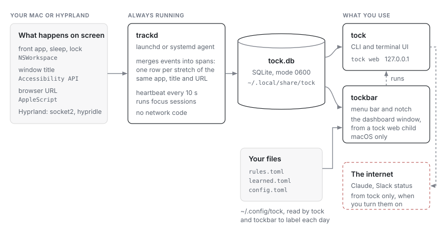
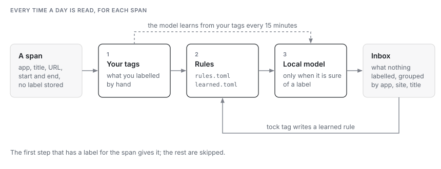
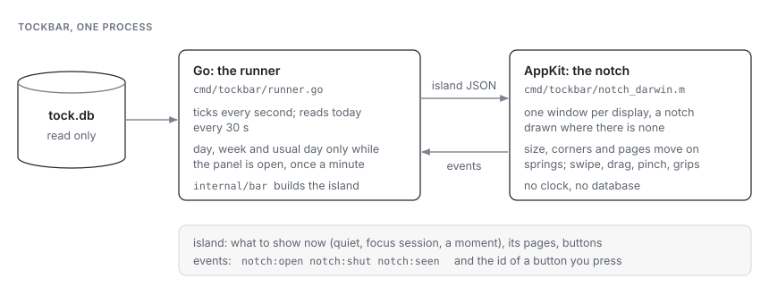
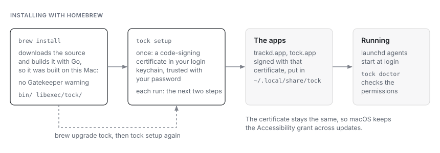

# Architecture

tock is three programs and one SQLite file. This page says what each part
does, how data moves between them, and what it costs to run.

## The pieces

| Program | Runs | Does |
| --- | --- | --- |
| `trackd` | always, as a launchd agent (macOS) or a systemd user service (Linux) | records the front app, window title, browser URL and idle time; runs focus sessions |
| `tock` | when you call it | the CLI, the terminal UI, and `tock web` for the dashboard |
| `tockbar` | at login, macOS only | the menu bar and the notch: today's time, sessions, `⌥⌘F`, the dashboard window |

All three open the same database, `~/.local/share/tock/tock.db`. They don't
talk to each other over a socket. trackd writes a heartbeat to the database
every 10 seconds, and the others read it to tell whether trackd is running.
The dashboard window in tockbar shows a `tock web` that tockbar starts as a
child and stops when nobody has used it for a while, so tockbar itself links
no HTTP code.

## Recording

On macOS, trackd listens for `NSWorkspace` app activation and reads the
focused window's title through the Accessibility API. Browser URLs come from
AppleScript, for browsers that allow it. Idle time is the seconds since the
last input event; sleep, wake, lock and unlock come from `NSWorkspace`
notifications. This is the only cgo in the project (`internal/collect`).

On Hyprland, trackd reads the compositor's event socket (`.socket2.sock`)
and gets idle and active from hypridle hooks.

A merger turns these events into **spans**: one row per stretch of the same
app, title and URL, with a start and an end in Unix milliseconds. A span is
extended in place while nothing changes, so a quiet hour is one row, not
360.

## Labelling

Spans are stored without labels. Every time a day is read, the rules in
`rules.toml`, your own tags and the local model label it again. That's why a
new rule applies to past days too.

The order: your own tags first, then the rules, then the model when it is
sure. What is left goes to the inbox. Labelling an inbox entry writes a
learned rule (`~/.config/tock/learned.toml`), so the next match is labelled by a rule.

The model is a small classifier trained on this machine from your labels. It
retrains every 15 minutes and when you tag something.

## Durability

Before a migration changes the schema, `store.Open` writes a compressed,
checked copy of the database to `backups/auto/`; if it can't, the
migration doesn't run. Each migration runs in its own transaction and
checks again inside it that no other program applied it first. trackd
takes a daily copy while you're away (`VACUUM INTO`, `quick_check`, gzip,
rename) and records the result, which `tock doctor`, `tock status` and the
menu bar read. CI opens databases written by released versions
(`internal/store/testdata/upgrade`) and checks they still open with every
row.

## The menu bar and the notch

tockbar is one process with two halves. The Go half reads the database
and decides what to show; the AppKit half draws it and has no clock and no
database of its own. They pass JSON across cgo: the Go half sends the
island, what the notch shows now with its pages and buttons, and the AppKit
half sends back what you did.

The pages in the open notch need the week and your usual day, which cost
more to build than today alone. The runner reads them when the panel opens
and once a minute while it stays open, and never while it is closed.

## Code layout

- **Pure packages:** `internal/span`, `classify`, `stats`, `focus`, `report`
  and `suggest` do no I/O and never read the clock. Callers pass the time in.
  Most of the tests are here.
- **`internal/store`:** SQLite through `modernc.org/sqlite` (pure Go, no cgo).
  The schema changes only through numbered migrations in
  `internal/store/migrations`.
- **`internal/app`:** what the CLI, TUI, web page and menu bar share: opening
  the store, loading rules and config, and building a day, a week or the
  inbox.
- **`internal/tui`, `internal/web`:** the terminal UI and the dashboard's
  server. The dashboard itself is React with shadcn/ui and Recharts, in
  `web/`. `make web` builds it into `internal/web/static`, which is
  committed, so building tock needs Go only.
- **`internal/bar`:** what the menu bar and the notch show, as plain data,
  so it is tested without AppKit. `cmd/tockbar` draws it.

## Installing

tock has no Apple Developer ID, so there is no notarized download. A build
made on your own Mac is not quarantined, so Gatekeeper doesn't stop it.
macOS ties a permission like Accessibility to the app's signature. Signing
every build with the same local certificate keeps that signature the same
from one version to the next, so updates keep the grant. `make install`
does the same from a clone, with `make cert` making the certificate.

The .dmg holds a small app, `cmd/tockapp`, with the same files inside it.
Opened from Applications, it runs the `tock setup` inside it, so a Mac
without Homebrew ends up with the same install. That one download is
quarantined, which is why its first open needs Open Anyway; what setup
installs from it is signed on the Mac and isn't.

## Network

trackd and tockbar have no network code. `cmd/trackd/deps_test.go` fails
the build if trackd ever imports `net/http`, `crypto/tls` or the Claude
client.

`tock` reaches the internet only for the features you turn on: Claude
suggestions and summaries (through the `claude` CLI or the API), and Slack
status. What they send goes through deny lists first, and `--dry-run` prints
it. The details are in [Privacy in detail](guide#privacy-in-detail).

`tock web` listens on 127.0.0.1 only. Each run makes a new token, which the
page keeps in the URL fragment so it never reaches a server log. The page
loads nothing from the internet; its fonts are bundled.

## Cost

Measured on an Apple Silicon Mac, November 2026:

| | |
| --- | --- |
| trackd memory | 36 MB footprint (budget 40 MB) |
| trackd CPU | 0.5 % averaged over days; about 1.3 % while a browser is in front |
| Building a day | about 2 ms after six months of history, the same as after a week |
| Database | about 9 MB after the first month |

Measure trackd's memory with `footprint $(pgrep trackd)`, not `ps`.
SQLite's memory is allocated outside the Go heap, and `ps` misses part of it.

## Testing

About 1,300 tests run with `make test`. The terminal UI has golden
snapshots in `internal/tui/testdata`. CI runs the tests without cgo on
Linux and with cgo on macOS.
