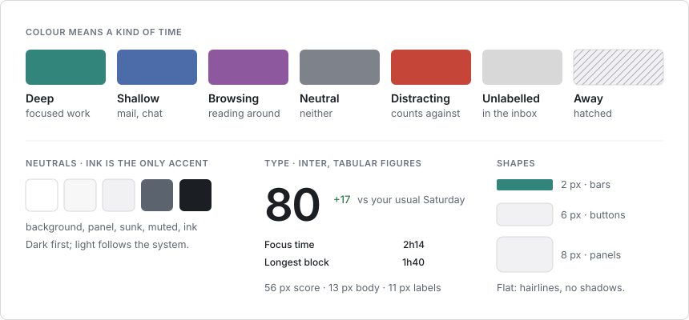

# Design

tock reads your day back to you like an instrument panel: one big reading, the charts that explain it, the tables underneath. Dark first, one typeface, colour only for the kind of time.

The dashboard, the terminal UI, the menu bar and the notch use the same
rules. The full tokens live in
[DESIGN.md](https://github.com/confuserdotcom/tock/blob/main/DESIGN.md).

## Colour

| Kind | Light | Dark | Means |
| --- | --- | --- | --- |
| Deep | `#32857a` | `#4fa89a` | focused work |
| Shallow | `#4c6ba9` | `#6f86b5` | mail, chat, admin |
| Browsing | `#8d589d` | `#a07fb0` | reading around |
| Neutral | `#7e828b` | `#7d8088` | neither good nor bad |
| Distracting | `#c64539` | `#c9625a` | counts against the score |
| Unlabelled | faint grey | faint grey | waiting in the inbox |
| Away | hatched | hatched | nobody at the machine |

- Colour is data, never decoration. Everything that is not a kind of time
  is grey, and ink is the only accent.
- Green and red mark a change against your usual day, and follow meaning,
  not direction: less distraction is green.

## Type

- Inter for everything, with tabular figures, so numbers line up without
  a monospaced face. 56 px for the focus score, 20 px page titles, 13 px
  body, 11 px labels in small caps.
- Durations read `2h24` in cards and charts, `2:24` in tables.
- Fonts are bundled. Nothing loads from the internet.

## Layout and shapes

- A 44 px top bar, a status strip, then panels in a grid with 20 px gaps.
- Flat: hairline borders, no shadows except popovers and toasts.
- 2 px corners on bars, 6 px on buttons, 8 px on panels.

## Motion

- Minimal: 120 ms hovers, 160 ms view changes. Numbers never count up and
  bars never grow.
- The notch is the exception. It grows out of the hardware, so it moves on
  springs. Reduced motion turns all of it off.

## Rules

- Every number has a unit and, where one exists, a comparison.
- Use rings and donuts for shares and goals, bars for time over time.
- One big number per screen. No gauges, no decorative gradients, no icon
  on every row.
