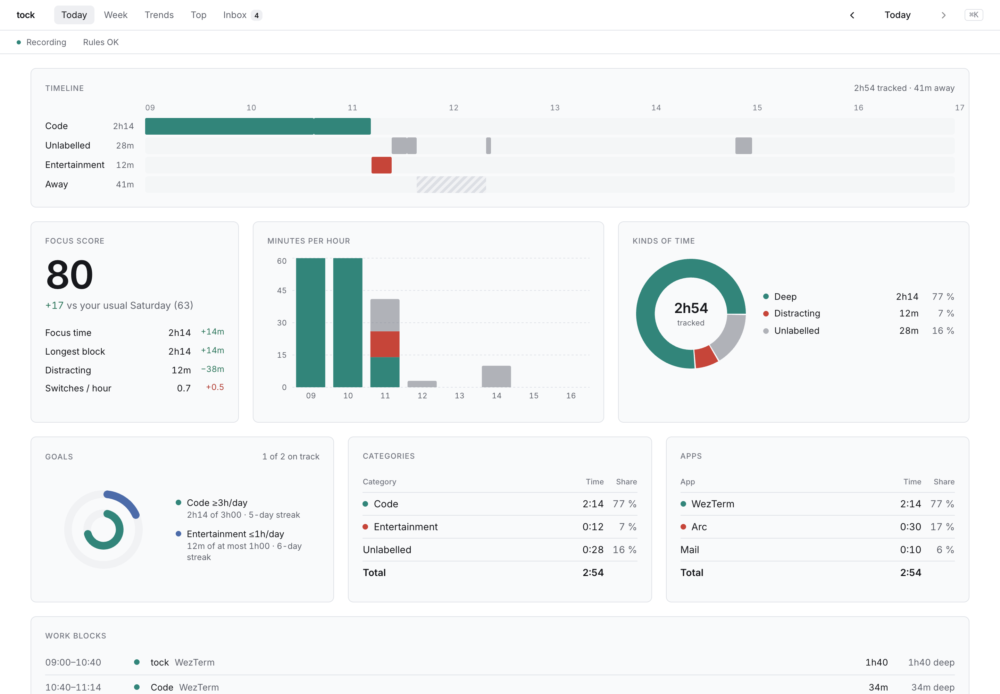
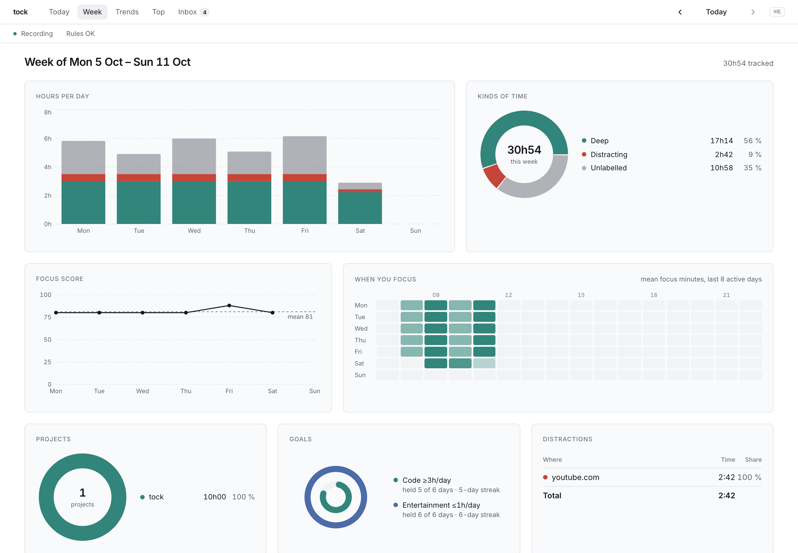
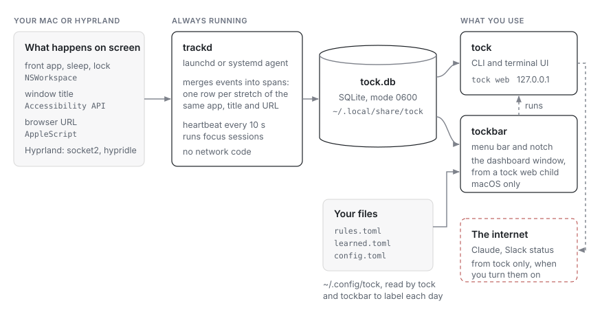

# tock

<p class="lead">tock keeps a record of your working time that you never have to start, stop or fill in, labels it with rules you can read, and turns it into invoices that don't change once issued. On a Mac or on Linux under Hyprland; your data stays on your machine, in one SQLite file.</p>

<picture class="shot">
  <source media="(prefers-color-scheme: dark)" srcset="readme/web-dark.png">
  
</picture>

<picture class="shot">
  <source media="(prefers-color-scheme: dark)" srcset="readme/web-week-dark.png">
  
</picture>

## What it does

- **Records without a timer.** `trackd` notes the app and window in front,
  the browser URL, and when you are away. It uses under 1 % CPU and about
  36 MB of memory, and it has no network code.
- **Labels with your rules.** `rules.toml` maps apps, titles and sites to
  categories and projects. Change a rule and past days follow.
- **Asks once.** Time no rule covers goes to an inbox. Labelling it there
  writes a rule, so the same thing is never asked again. A model trained on
  your own labels, on your machine, suggests the rest.
- **Says why.** Every label records whether a rule, you, or the model
  set it, and a new rule shows what it would relabel before you save it.
- **Bills from the record.** Rates per project and `tock invoice issue`:
  a numbered invoice, stored with its PDF, that later relabelling never
  changes. `tock invoice check` shows what would differ today.
- **Shows the day plainly.** A terminal UI, a dashboard on 127.0.0.1, and a
  menu bar app. Every number is compared with your usual same weekday.
- **Focus sessions, if you want them.** `tock session start 50` or `⌥⌘F`
  from any app. tock calls you back when you drift. `tock choice focus off`
  hides all of it.

## Install

On macOS, with Homebrew:

```sh
brew tap confuserdotcom/tock
brew trust confuserdotcom/tock
brew install tock
tock setup
```

Homebrew builds tock on your Mac, so there is no "unidentified developer"
warning. `tock setup` makes a local code-signing certificate, installs
trackd and the menu bar app, and starts them.

Without Homebrew, download the `.dmg` from
[Releases](https://github.com/confuserdotcom/tock/releases). It isn't
notarized, so the first time you open it, allow it under System Settings,
Privacy & Security, Open Anyway. To build from source, see the
[README](https://github.com/confuserdotcom/tock#install).

On Linux under Hyprland, run `make install-linux`, or download a tarball
from [Releases](https://github.com/confuserdotcom/tock/releases). Coming from
ActivityWatch? `tock import activitywatch export.json` brings your history.

## How it fits together



More in [Architecture](architecture).

## Privacy

- Activity is stored in `~/.local/share/tock/tock.db` (mode 0600) and leaves
  the machine only if you export it.
- A test fails the build if `trackd` ever links an HTTP or TLS client.
- Private windows, and apps and sites you hide, are recorded without title
  or URL.
- Claude suggestions, summaries and Slack status are the only network
  features. All are off by default, and `--dry-run` prints exactly what
  would be sent.

The whole list is in [Privacy in detail](guide#privacy-in-detail).

## Read next

- [Guide](guide): every command, file and setting.
- [Architecture](architecture): how the pieces fit, and what they cost.
- [Stability](stability): what tock promises about your data and upgrades.
- [Design](design): colours, type and the rules every screen follows.
- [Changelog](https://github.com/confuserdotcom/tock/blob/main/CHANGELOG.md).
